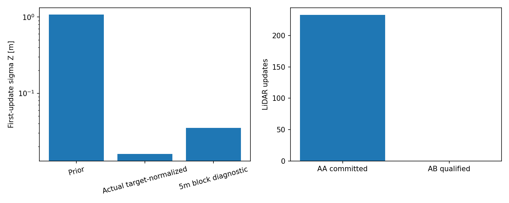

# AB3 — first committed geometry update

The first update was committed at the iteration limit without final stationarity qualification. Full predicted/corrected state and 15x15 P, cumulative error, actual factors, residuals, robust weights, Source/Target IDs and complete cross terms are preserved privately. The audit uses the ACTUALLY committed pose, not the independently refined replacement.

## Exact numerical mechanism

At the frozen final chart, compute `M=I+(H_z L)^T W(H_z L)`, then `P_chart=L solve(M,L^T)` and transport ONCE with the error-reset/chart Jacobian. This operation is executed whenever the old final support/finite checks pass, including `MAX_ITERATIONS`. There is no convergence gate before the full information posterior is committed.

| Audit quantity | Value |
|---|---:|
| Prior / posterior sigma Z | 1.077426997 / 0.015979144 m |
| Z variance shrink factor | 4546.411126 |
| Direct map-Z information diagonal | 8131.471817 /m² |
| Final GN white-step / dual-gradient norm | 0.443617 / 30.939004 |
| Raw supported residual median / P90 / max | 0.174572 / 0.645455 / 0.918563 m |
| Huber-downweighted fraction | 0.333697 |

All pose cross terms and the complete prior covariance are used, including position/attitude lever-arm effects. The six-pose block uses world translation and the frozen right-attitude chart, not an untransported body-twist information matrix. The scalar diagonal alone does not determine marginal posterior variance. Full posterior reconstruction agrees with AA to numerical precision; `NUMERIC_INFORMATION_VALID=PASS`. The high residual tail and nonzero optimality residual do not support a claim of a well-fitted converged observation.

## Information counting and correlation

There are 917 residuals and 732 unique Targets: 185 additional Target uses, maximum multiplicity 4. Base weights sum to `1/sigma²` per unique Target, maximum error 3.55271e-15. Thus an EXACT repeated-Target counting bug is not found; the intended normalization is implemented.

This still approximates unique-target factors as independent. Normal fits use 14640 neighbor instances but only 5213 unique map points, repeated-use fraction 0.643921. This proves shared geometric construction, NOT a calibrated measurement-error correlation coefficient. Map, normal, deskew and shared inertial errors are not fully modeled.

142 source-space 5m blocks contribute. Largest block / top three shares of Z information are 0.056946 / 0.152936, effective block count 45.671. No one source block dominates, but a single physical plane can span many blocks; physical-plane dominance is NOT excluded without segmentation. Normals with |nz|>=0.8 are 0.536532 of residuals and supply 0.948270 of direct Z information. They are not automatically labeled ground.

Reusing the historical 5m block weights at the SAME frozen pose/factors gives sigma Z 0.035200558 m, versus 0.015979144 m under actual Target normalization. This is a sensitivity diagnostic, not a calibrated covariance, new noise setting or proposed filter parameter. The filter weights were never changed.

Conclusion: `GEOMETRY_INFORMATION_TRUSTWORTHY=NOT_VALIDATED`. Valid matrix algebra, many support points, repeated-target normalization and a large Hessian do not justify the posterior as calibrated information at an unconverged, reassociating pose.

Public scope: de-identified research aggregates; no sensor timestamps, global trajectories, map points, equipment/extrinsic details or restricted production code are published. All state/P/factor arrays and event-level identities remain private. Numerical qualification is not independent accuracy or statistical calibration. Code/data bindings and reproduction prerequisites are in [manifest.json](manifest.json) and [REPRODUCE.md](REPRODUCE.md).

Additional standardized structure: normalized information-column coupling of Z with right-attitude x/y/z is -0.549247, -0.691617, 0.238434. These are normalized Jacobian information cross terms, NOT posterior state correlations. The six nonzero prior-white information eigenvalues are 152.902052, 4183.995482, 5345.831761, 16245.922098, 110635.037979, 179264.901535. The full six-dimensional cross matrix is retained, not reduced to a scalar Z observation.
