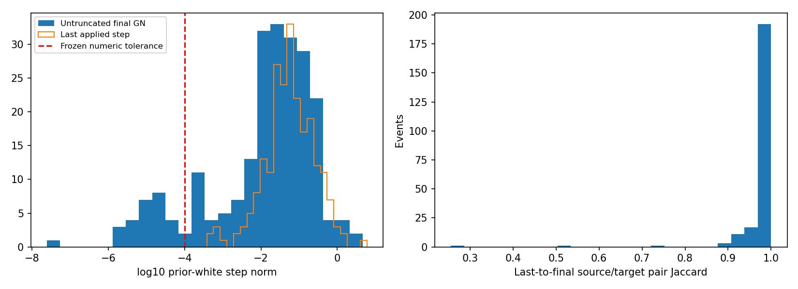

# AB1 — all iteration-limit acceptances

Reused the published AA baseline and saved per-iteration traces. Reconstructed all 226 `MAX_ITERATIONS` acceptances, all seven old `CONVERGED` acceptances, and the first rejected large-proposal event. Matching was queried at the RECORDED states solely to recover missing Source indices, residual/Jacobian/weights and final derivatives; there was no baseline filter replay. Stored Target-ID order matched exactly. Maximum reconstructed fixed-cost error 2.18279e-11; maximum full posterior-P error 4.78106e-12.

## Objective and scales

The frozen prior chart uses error order `[dp_world,dv_world,dtheta_right,dbg_body,dba_body]`. With `P=L L^T`, `u=L^-1 z`, exact Huber residual gradient `g_u=u+(J L)^T W r`, and local GN matrix `M=I+(J L)^T W (J L)`, compute the untruncated direction `du=-solve(M,g_u)`. Report `||du||`, `||g_u||`, and `sqrt(g_u^T solve(M,g_u))` (GN-metric dual-gradient/Newton decrement). The last quantity is model-based, not a hard-constrained KKT certificate. Robust influence weights and the TRUE Huber objective agree. No raw mixed-unit 15D Euclidean gradient is used for comparison.

Last APPLIED iteration steps are reconstructed independently from saved accepted coordinates; they are not substituted for the final untruncated next step. The last two line-search decreases are each evaluated with THAT iteration's frozen correspondence set; a difference between reassociated objectives is not common-objective descent.

## Census

| Final condition among 226 | Count |
|---|---:|
| Original untruncated prior-white step <= frozen 1e-4 | 28 |
| Both step and dual-gradient <= same frozen numerical tolerance | 26 |
| Exact last-linearization/final Source–Target pair equality | 48 |
| Joint conservative local + association witness + safety qualification | 26 |
| Last iteration was scaled down | 4 |

26 events reached the joint numerical certificate only AFTER the fourth accepted step. The old loop checks convergence BEFORE a step but never rechecks after its last step; their `MAX_ITERATIONS` label therefore does not by itself mean nonconvergence. The other 200 lack this certificate. Of them, 22 retain identical last/final pairs but are not locally stationary; 178 change pairs. Pair changes are not automatically physically bad: median pair Jaccard is 0.994123, and many changes are small.

The seven old solver-convergence labels yield six joint certificates. The remaining event has step norm 6.298e-5 and dual gradient 1.057e-4, just above the inherited tolerance. This is a conservative POLICY difference, not proof of an incorrect physical state.

## Distributions over all 226

| Quantity | Min | P50 | P95 | Max |
|---|---:|---:|---:|---:|
| Final untruncated GN white-step norm | 2.4529e-08 | 0.0265647 | 0.378406 | 4.63259 |
| Final exact white-gradient norm | 5.24988e-08 | 0.1844 | 6.31262 | 8755.64 |
| Final GN dual-gradient norm | 3.24547e-08 | 0.0492003 | 1.14082 | 30.939 |
| Last applied white-step norm, at preceding iterate | 0.000381419 | 0.0575376 | 0.552835 | 6.08317 |
| Last pre-step untruncated norm, at preceding iterate | 0.000381419 | 0.0575376 | 0.695864 | 6.08317 |
| Last accepted scaling | 0.0625 | 1 | 1 | 1 |
| Final true Huber MAP objective, frame-specific factors | 24.8787 | 101.972 | 330.834 | 1181.88 |

Costs across different frames or factor sets are not accuracy rankings. Full derivative vectors, cumulative corrections, final information matrices and raw P arrays are retained in the private frame table. [key_results.json](key_results.json) gives the complete aggregate quantiles, source/target retention, normal changes, final reassociation jumps and covariance ratios.

Public scope: de-identified research aggregates; no sensor timestamps, global trajectories, map points, equipment/extrinsic details or restricted production code are published. All state/P/factor arrays and event-level identities remain private. Numerical qualification is not independent accuracy or statistical calibration. Code/data bindings and reproduction prerequisites are in [manifest.json](manifest.json) and [REPRODUCE.md](REPRODUCE.md).
