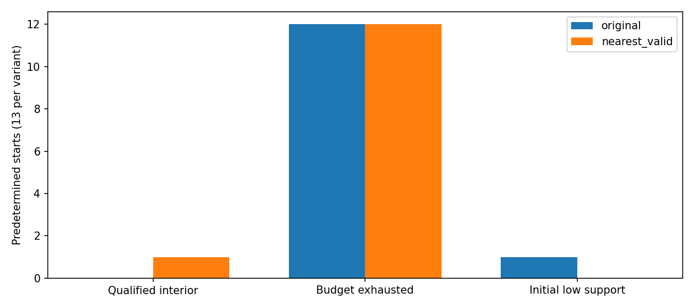

# AC3 — predetermined starting coordinates, not changed priors

Exactly 13 starts were fixed before outcomes: original zero error plus +/- six Cholesky directions of the frozen marginal pose covariance. Other nine coordinates are their Gaussian conditional means. Each start is <=0.25 prior-white units and <=25% of every original engineering ball. Starts affect only optimizer initial coordinates; the frozen prediction/prior center, state meaning, P and observations never change. No starts or radii were added after seeing success.

| Variant | Interior certificates | Budget-exhausted | Initially unsupported |
|---|---:|---:|---:|
| Original association | 0 | 12 | 1 |
| Nearest-admissible candidate | 1 | 12 | 0 |

All twelve original budget outcomes repeat with period two to near double precision and coincide with the nominal two-phase orbit. All twelve candidate budget outcomes repeat with period five and coincide with the nominal five-phase orbit. These are periodic attractors, NOT twelve local minima. Endpoint/lag errors for each start are in key_results.json. The numerical repeat diagnostic uses sqrt(machine epsilon) only for describing saved repeats; it never changes solver stopping or eligibility.

The one candidate interior certificate comes from a PREDECLARED positive marginal-pose axis start. It converges in 13 outer steps with GN norm 5.796e-12, dual gradient 1.457e-9 and 1,979 supported factors. Original guard margins stay positive. Under the ORIGINAL rule the SAME start was initially unsupported (355/4,005 points); the candidate's nearest-admissible rule yields 519 initial support points, exceeding the unchanged 10% support requirement. This is a measured capture effect of the selection rule, not a retuned initialization.

There is only ONE certified first-frame numerical endpoint in the tested set. No evidence establishes multiple qualified local extrema; other distinct solver phases are cycles. This finite directional design does not prove uniqueness or characterize the full physical capture volume.

Twelve deterministic pose-white perturbation QUERIES at the existing 1e-4 tolerance were made around the certified endpoint: 3 change pairs, 9 retain them. No local-restart optimization was performed at those probes. Exact endpoint fixed-point evidence therefore does not establish a robust neighborhood/capture basin or global convergence. Do not interpret pair changes alone as a physically wrong pose.

The nominal prediction remains uncertified for BOTH algorithms. The successful nonnominal start is NOT promoted to replace the original initialization, and no best-cost seed is selected for filtering. There is no qualified independent GNSS/RTK reference established in this experiment; no truth alignment or truth-based seed choice was performed.

Publication boundary: independent research code and de-identified numerical aggregates only. Full state/P, map/Source points, event timestamps, Target identities, equipment/extrinsic information and original project source are not distributed. No independent pose accuracy, calibrated covariance or production qualification is inferred from local numerical results. See [manifest.json](manifest.json) and [REPRODUCE.md](REPRODUCE.md).
