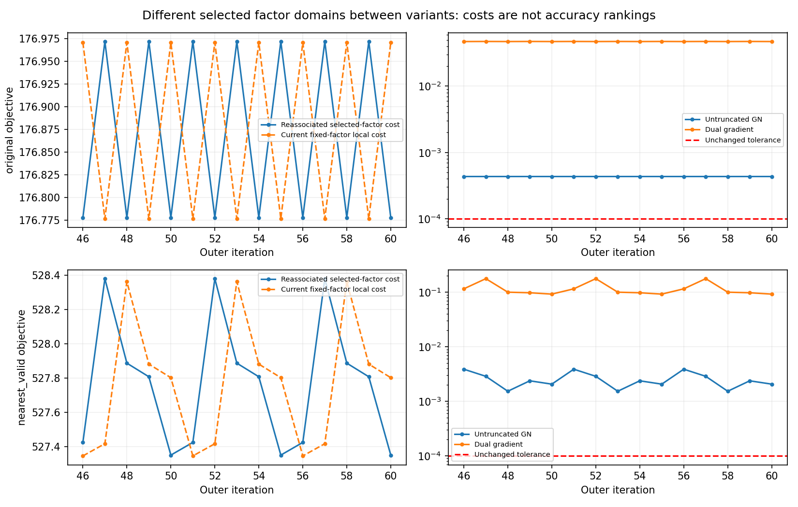

# AC2 — more compute reveals a selection cycle

The diagnostic starts from the ORIGINAL prediction. At each outer step, query original correspondences, hold those factors fixed, optimize the exact full15 Huber MAP with the SAME frozen prediction/P, then requery. The local reference is SLSQP with the existing 200-iteration/1e-12 settings. Cumulative original norm-ball guards are explicit constraints. Every accepted outer step also respects the original 0.5m translation and 0.05rad attitude-chart step limits, with the original backtracking scale set. Local cost decrease is NOT automatically reselected-set decrease.

Nominal original-rule run: 60 outer steps, final GN norm 0.000433464, dual gradient 0.047155190; no active original cumulative guard. The last ten local solves succeeded and accepted full outer steps. This is not line-search clipping or a first-frame Bias-bound limitation. The last two-state repeats differ by at most 7.16117e-14 prior-white units, while adjacent phases differ by about 0.000448614. Twelve of 13 predetermined starts reach the SAME numerical two-cycle; the remaining start lacks initial support.

## Cross-factor evidence

| Factor set | State | True fixed-factor cost | GN white norm | Dual gradient |
|---|---|---:|---:|---:|
| 0 | 0 | 176.971829438 | 0.000433535 | 0.0472985 |
| 0 | 1 | 176.970684380 | 1.35357e-09 | 1.46438e-07 |
| 1 | 0 | 176.776786313 | 9.39852e-10 | 9.95743e-08 |
| 1 | 1 | 176.777924647 | 0.000433464 | 0.0471552 |

Each cycle state is nearly optimal for the OTHER phase's factor set, not for its own re-queried set. A fixed decrease around 0.00114 is overwhelmed by a re-selection geometry-cost jump of about 0.195043. Thus extra accurate local optimization does not establish a dynamic fixed point.

## Direct trigger

Exactly ONE Source enters/exits the support set. Its raw nearest Target switches from a valid plane fit to an invalid fit. Both nearest distances are inside the original 1m radius (approximately 0.446762 and 0.446308m); this original cycle is NOT triggered by the radius limit. Plane-fit ratios are 0.036824358 and 0.050437504, straddling the original 0.05 predicate; other original fit predicates pass. The implementation first chooses nearest raw Target, THEN rejects an invalid normal, deleting a factor even when a nearby valid Target exists.

This is an active-factor/selection-objective discontinuity, not proof of a coding error in the documented nearest-then-reject rule. The exact Huber local gradient and local numerical optimizer remain consistent. Do not fix it by raising the planarity cutoff or lowering the guard. Huber cannot smooth deletion of an entire factor by another predicate.

A predeclared nominal extension to 120 steps was NOT used: repeating two-cycle evidence already identifies method-level stalling within this test. No iteration-limit label is promoted to convergence.

Publication boundary: independent research code and de-identified numerical aggregates only. Full state/P, map/Source points, event timestamps, Target identities, equipment/extrinsic information and original project source are not distributed. No independent pose accuracy, calibrated covariance or production qualification is inferred from local numerical results. See [manifest.json](manifest.json) and [REPRODUCE.md](REPRODUCE.md).
