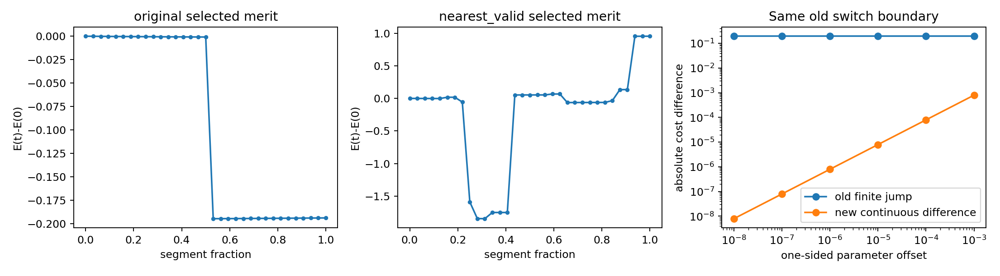

# AD1: directly measured discontinuities

Define the old queried merit explicitly: E_old(z)=0.5||L^-1 z||² + sum over selected source/target pairs of w(z) Huber(r(z)). This is a well-defined piecewise function, although its selected population and repeat weights change. It is not the same function as a single frozen-factor merit. Comparing different frozen factor objectives as if they were repeated evaluations of one smooth function was unjustified.

## Executed evidence

Seven stored cycle edges were sampled at 33 equally spaced fractions. Within each initial interval with a changed factor/weight signature, the FIRST detected change was bracketed by 40 bisections; one-sided offsets range 1e-3..1e-8. The audit finds **43 boundary records**: 2 on reciprocal original edges, 41 on five nearest-valid edges. These are not 43 independent physical boundaries; reciprocal edges overlap and sparse cells can hide switches that cancel. This is a detection lower bound, not an exhaustive boundary census.

All 43 detected records have a nonzero same-state factor-switch jump (absolute range 0.00141014016..1.80441795). The original edge's jump tends to **-0.193895945851**, not zero, when offset tends to 1e-8. Source support switches 880→879. Same-state decomposition attributes the whole jump to the lost factor; inherited AC map-fit identity confirms the nearest raw Target becomes normal-invalid while distance stays inside the unchanged radius. This is an actual value discontinuity, not just derivative discontinuity.

Nearest-valid does not cure other boundaries. **28/43 records have unchanged Source population but nonzero jump**. Euclidean-nearest valid planes can have different normals and point-plane residuals at equal Euclidean distance; Huber losses need not agree at the tie. Across records there are 28 valid-Target switches and 13 radius crossings. At radius a nonzero point-plane loss is removed/added. The exact per-factor common-state decomposition also finds **34/43 records with nonzero contributions from changed repeat-Target weights**; 74 retained-factor weight changes are counted. Categories overlap and are not exclusive causes.

For each detected boundary, private evidence preserves source/target identity, normal, residual, Huber value, Huber weight, base repeat weight, population membership, previous/new target distances and raw-nearest validity. Public [key_results.json](key_results.json) preserves signed loss decomposition, normal-change angle and counts without identifying points. Terms retain sign and sum to the measured jump; they are not absolute percentage attributions.

## What is and is not continuous

Within a fixed active cell the exact Huber objective and gradient are continuous. Huber is C1 at its breakpoint; only its second derivative changes. Ordinary equal-energy plane switches could be continuous with different one-sided gradients, but the 43 detected records are finite value jumps. No claim is made that every conceivable nearest-neighbor switch must jump. A selected-objective drop caused by losing a factor is not evidence of better map alignment.

Evidence boundary: executed frozen-input results are stated above; AC results are explicitly historical reuse. Physical pose correctness, calibrated uncertainty, and continuous Z/vz improvement are not inferred. Raw points, full states/P, map, timestamps, identities and sensitive configuration stay in ignored local data. Speculative next steps are not executed results.
