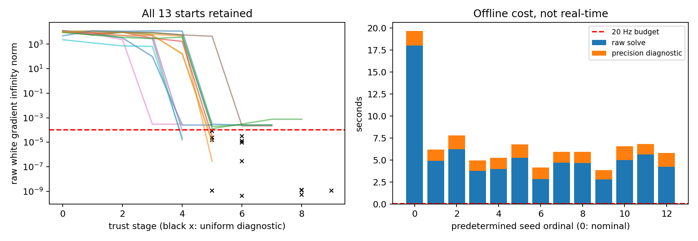

# AD4: complete frozen A/B/C comparison

## Historical A/B, without replaying their optimizations

A/original: 12/13 budget-exhausted, same two-cycle; 1/13 initially low support; no interior endpoint. B/AC nearest-valid: 12/13 budget-exhausted, same five-cycle; 1 nonnominal seed interior endpoint. A/B raw objectives have different factor populations; no absolute cost ranking against C is valid. Their original runs and times are retained in [key_results.json](key_results.json).

## One new C objective, all starts

Same source/map, prior/P, 13 AC seeds, Huber, radius, map-normal validity and engineering limits. The new association mixture replaces nearest assignment AND discontinuous repeat weights, which is explicitly a different observation objective. It is not described as unchanged LiDAR likelihood/noise calibration.

Raw SLSQP: **7/13 interior certificates, 6/13 no-descent/stall**. Nominal fails the declared raw gradient tolerance (2.52462e-4>1e-4). Its final six trust stages reduce the unified objective to 18335.0604274338 without an AC-style periodic orbit, but it must not be relabeled converged.

The [uniform precision diagnostic](PRECISION_DIAGNOSTIC_PLAN.md) is documented AFTER the raw result and applied identically to ALL 13 endpoints. It keeps the SAME objective, original safety balls, step balls and line scale set. No tolerance relaxation. Six failing endpoints each need one tiny SPD-Hessian Newton correction. Nominal white step=4.69904e-9, analytic gradient ∞=4.22745e-10 afterward; predicted cost change=-5.03e-13 while measured change=+1.82e-11, inside the predeclared 1e-10 roundoff floor. Thus cost descent below resolution is NOT claimed; stationarity is verified independently from the complete analytic gradient and curvature. This is an offline numerical probe, not an already integrated reliable production solver.

|Seed|Raw status|Stages|Raw white gradient ∞|After uniform probe|Root group|
|---|---|---:|---:|---:|---|
|nominal|NO_FEASIBLE_DESCENT|6|0.0002525|4.227e-10|G1|
|axis0_minus|INTERIOR_OBJECTIVE_STATIONARY|6|2.795e-07|2.795e-07|G1|
|axis0_plus|NO_FEASIBLE_DESCENT|9|0.0007504|1.126e-09|G1|
|axis1_minus|INTERIOR_OBJECTIVE_STATIONARY|6|3.135e-05|3.135e-05|G1|
|axis1_plus|INTERIOR_OBJECTIVE_STATIONARY|5|8.477e-05|8.477e-05|G1|
|axis2_minus|NUMERIC_STALL_NOT_CONVERGED|8|0.000216|1.211e-09|G1|
|axis2_plus|NUMERIC_STALL_NOT_CONVERGED|5|0.0002973|1.134e-09|G2|
|axis3_minus|INTERIOR_OBJECTIVE_STATIONARY|5|1.56e-05|1.56e-05|G1|
|axis3_plus|INTERIOR_OBJECTIVE_STATIONARY|6|9.679e-06|9.679e-06|G1|
|axis4_minus|INTERIOR_OBJECTIVE_STATIONARY|5|2.321e-05|2.321e-05|G2|
|axis4_plus|NO_FEASIBLE_DESCENT|8|0.0002524|5.253e-10|G1|
|axis5_minus|INTERIOR_OBJECTIVE_STATIONARY|6|1.238e-05|1.238e-05|G1|
|axis5_plus|NUMERIC_STALL_NOT_CONVERGED|8|0.000255|1.262e-09|G1|

All 13 endpoint probes are feasible interior stationary points with positive Hessian curvature at white offsets 1e-4/1e-5/1e-6. Raw failures remain visible above. No active Bias or total-pose guard explains nominal failure; no velocity clipping or deleted covariance cross-terms are used.

## Multiple solutions are real evidence, correctness is unknown

11 seeds, including original prediction, reach G1 (objective 18335.06042743); two preselected seeds reach G2 (20995.98671875). The separation is **0.882025 prior-white units**; both have positive local curvature. This establishes TWO numerical local minima of C within the tested starts, unlike AC's unqualified periodic attractors. It does not establish which pose is accurate or rule out other minima. No favorable seed is promoted or omitted. No prior is recentered.

At G1 support=2026/4005, 8447 plane-candidate pairs, 2534 distinct candidate Targets, continuous plane responsibility mass≈1547.73. Raw support means at least one valid plane in radius, NOT that all those observations are independent. At the same G1 pose the old selectors still have GN norms 0.290222 and 0.228719: C solves a different objective, not the old point-plane target loss by another optimizer.

Evidence boundary: executed frozen-input results are stated above; AC results are explicitly historical reuse. Physical pose correctness, calibrated uncertainty, and continuous Z/vz improvement are not inferred. Raw points, full states/P, map, timestamps, identities and sensitive configuration stay in ignored local data. Speculative next steps are not executed results.
