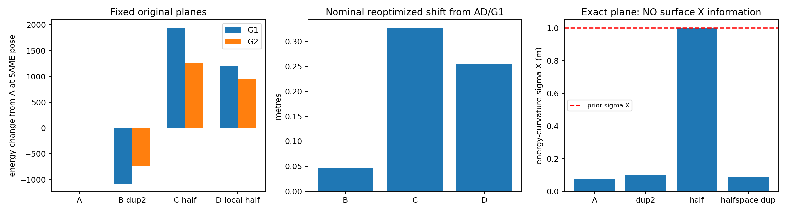

# Density is a state-dependent latent prior in the unchanged AD objective

## AE1 identity and endpoint reproduction

Remote main was Phase AD3198fe2 and local tree clean at start. AD source hash, full prediction/P, Source/Target hashes, native time binding, frozen configuration and all13 optimizer seeds are preserved. All13 saved AD endpoints are re-evaluated (no repeated capture): energy errors <=1e-8. G1/G2 numerical Hessians repeat exactly at the AD1e-5 stencil. Original AD minima remain G1=18335.0604274338 and G2=20995.9867187514. No new favorable initializer or changed objective.

## AE2 pure density: FIRST keep the exact original planes

|Arm|Target records|Definition|
|---|---:|---|
|A|908013|Original|
|B|1816026|Two exact aliases of every record; identical xyz/normal/validity|
|C|460384|Alternating lexicographic ranks within every5m cell, about half|
|D|903607|Apply C only in95 high-density candidate cells, others unchanged|

D removes4406 records globally, but it is NOT a negligible perturbation of active support: G1 candidate pairs fall8447→5891 (~30.3%). The candidate pool has12541 original IDs; dense cells were selected by counts BEFORE outcomes, not residuals. C/D do not move any retained coordinate or refit a normal; finite surface representation/coverage changes with sampling. B is the strict identical-geometry counterexample. Eight multiplicity-algebra versus materialized-map checks agree within3.64e-12; exact per-factor identities and weights are privately bound.

|Same frozen state, original planes|E at G1|E at G2|G1 white gradient infinity|G1 inverse-curvature sigma Z(m)|G1 candidate pairs|
|---|---:|---:|---:|---:|---:|
|A|18335.060427|20995.986719|4.227e-10|0.00783026|8447|
|B|17258.490577|20266.350241|321.1|0.00777346|16894|
|C|20281.453114|22264.545625|1022|0.00944395|4339|
|D|19541.782635|21947.110177|951.4|0.00846489|5891|

G1 remains lower than G2 at these SAME frozen states in all four arms: no fixed-root rank reversal is claimed. Pure duplication alone makes a previous stationary G1 have gradient≈321.06 without new geometric information. C/G2 has NONPOSITIVE Hessian, so no Gaussian sigma is invented there. All frozen inverse-curvature sigmas are diagnostics at potentially nonstationary states, not posterior covariances.

Duplicate record IDs are not independent original Target identities. At G1, B has5068 record IDs but only2534 original identities, same as A. The lower bound on original unique IDs across EVERY B solver stage (including normal-refit) is943, above the original80 support limit: no observed guard pass is manufactured by alias counting. Original state/step balls also remain unchanged.

## Reoptimization, SAME13 starts and unchanged prior

A reuses AD's13 polished results (11/2 minima); B/C/D each run all13 same seeds using the unchanged AD solver and its uniform precision probe.

|Arm|Qualified interior endpoints|Observed stationary clusters|Failed endpoints|
|---|---:|---|---|
|A historical|13/13|11 and2|0|
|B pure duplicate2|12/13|12 at one observed cluster|axis4_plus|
|C pure half|12/13|10 and2|axis4_plus|
|D local half|13/13|11 and2, different seed membership from A|0|

Clusters are limited to observed stationary endpoints; B's missing second cluster does not prove no other minimum exists. Raw failures/stalls and post-probe status are both retained for every seed in key_results.json. No failed endpoint is counted as a minimum. Density changes basins and stationary locations, not just cost scaling.

|Nominal fit, original planes|Translation shift from AD/G1(m)|Absolute X/Y/Z changes(m)|Energy-curvature sigma Z(m)|
|---|---:|---|---:|
|B|0.046755|0.016220, 0.043138, 0.007876|0.00768073|
|C|0.326583|0.095842, 0.312079, 0.008800|0.00853289|
|D|0.254246|0.061973, 0.246560, 0.002875|0.00835162|

Full signed XYZ/RPY and15D corrections are retained privately; public key_results contains deidentified relative magnitudes, all seed outcomes, support, spectra, sigma XYZ/RPY and Z-vz coupling diagnostics. No actual trajectory is published or committed. Conditional K_vz,Z≈0.690933 remains unchanged up to roundoff where defined, as expected for pose-only energy with the SAME complete Gaussian prior. Density changes pose requests and curvature, not the prior conditional-recovery law. No inference about actual velocity spikes is made.

## SECOND: resample and refit normals, separate from multiplicity

Keep20-neighbor/validity rules fixed but estimate on B/C/D resampled records. Nominal translations from AD/G1 become0.221082/0.353463/0.263688m. Relative to the SAME-density fixed-plane fits, the EXTRA changes are0.265662/0.047821/0.032252m. At frozen G1, median original-versus-refit normal angles are6.035°/5.940°/0.616°, with maxima71.03°/47.16°/33.38°. B duplicates make20 nearest records cover roughly fewer unique positions; they are not equivalent to the original20-point plane neighborhood. Validity flips and complete G1/G2 angle distributions are reported separately. These effects must not be attributed solely to mixture multiplicity.

Evidence boundary: real-input values above are deidentified diagnostics, synthetic controls are explicitly separate, and historical AD results are reused rather than repeated. No absolute accuracy, statistical calibration or production qualification is inferred. Full Source/map/normal/state/P/trajectory records, factor identities and matrices remain in ignored local data. Proposed future model work is not an executed fix.
