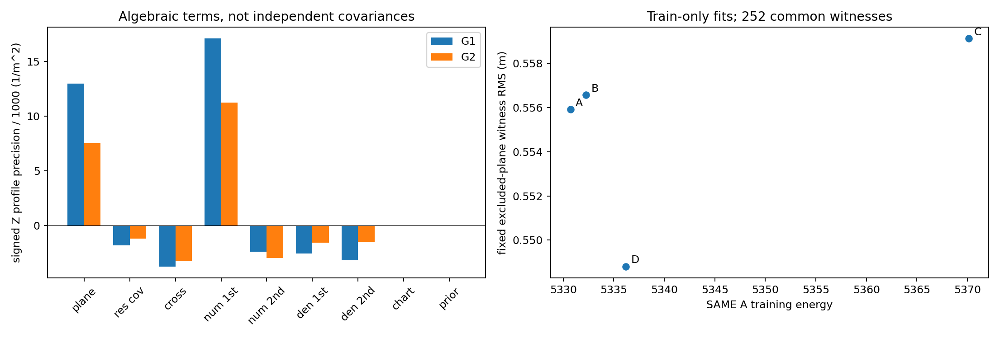

# Exact signed information-source audit

Use original delta order[p,v,theta,bg,ba], full15 frozen prior, same nonlinear right-attitude error chart and IMU/base lever. Never discard cross terms or invert only a selected Z diagonal. Full matrices in physical and prior-white charts, eigenspectra/eigenvectors, and the per-direction profiles are retained locally with hashes. Public artifacts expose deidentified spectra, standardized axis loadings, cross-coupling summaries and signed directional contributions, not private P or map-derived full matrices.

For one Source, use symbols in OBJECTIVE_FORCE_DECOMPOSITION. With Hk_j=grad² k_j and Hrho_j=grad² rho_j, the Cartesian Hessian is the SUM of:

1. plane_intrinsic=sum a_j Hrho_j;
2. residual_responsibility_covariance=-(sum a_j v_j v_jᵀ - V Vᵀ)/tau;
3. kernel_residual_cross=sum exp(-rho_j/tau)(u_j v_jᵀ+v_j u_jᵀ)/Z -(U Vᵀ+V Uᵀ);
4. numerator_kernel_first=tau U Uᵀ;
5. numerator_kernel_second=-tau sum exp(-rho_j/tau)Hk_j/Z;
6. normalization_density_first=-tau gD gDᵀ/D²;
7. normalization_density_second=tau sum Hk_j/D.

Divide by sigma², pull back each complete3x3 Source term through dy/dz and L, add nonlinear state-chart curvature (sum grad_yE * grad²_z y) and prior I. Radius kernel second derivatives and Huber piecewise second derivative are explicit. This is an EXACT chain-rule grouping where differentiable, not a unique allocation of physical information. Signed summands are NOT independent R/covariances; some are negative semidefinite and others indefinite. In particular plane_intrinsic already uses density-dependent a_j, so it is not a calibrated density-free surface-information term.

## Reconstruction and new checks

Ten NEW tests pass: full signed Hessian/force reconstruction, prior chart, expected signed first-order components, fixed-plane alias identity, deterministic sampling, nonpositive-Hessian refusal and spatial core separation. No AD nine-test/Jacobian proof suite is repeated. AD original finite-difference Hessian repeats exactly. Analytic-versus-numeric reconstruction at1e-6 gives relative errors2.14e-9(G1),1.94e-9(G2). Larger1e-5 G2 error3.32e-5 is preserved: finite differences can straddle Huber breakpoints (nearest residual gap1.10e-5m). Step sweeps1e-4/1e-5/1e-6/1e-7 reveal truncation then roundoff; no stencil is hidden.

Full white condition numbers are≈420810(G1) and250568(G2); nine white eigenvalues≈1 reflect only pose-dependent geometry. Private physical-chart matrices show the full prediction cross-correlations and nonlinear-chart terms, rather than a pose-only posterior pasted into15D. Public cross-coupling summaries include position/attitude and Z/Roll contributions.

## Signed Z marginal-profile precision

For a physical scalar q, a=dq/du, H=full15 white Hessian, d=H^-1 a/(aᵀH^-1a). Evaluate dᵀ H_term d. The SUM is1/variance(q), fully allowing all nuisance states/cross terms to adjust. This is not the raw H_ZZ diagonal, nor independent precision addition.

|Term|G1 Z profile (1/m²)|G2 Z profile (1/m²)|
|---|---:|---:|
|plane_intrinsic|12972.923246|7500.026153|
|residual_responsibility_covariance|-1834.329356|-1222.771280|
|kernel_residual_cross|-3768.970445|-3267.924008|
|numerator_kernel_first|17117.718509|11228.182584|
|numerator_kernel_second|-2408.279003|-3017.732521|
|normalization_density_first|-2567.933644|-1602.114316|
|normalization_density_second|-3201.054767|-1510.311197|
|state_chart_curvature|-1.237816|-0.842444|
|prior|0.918988|1.080586|
|TOTAL|16309.755712|8107.593558|

G1's explicit kernel/cross/normalization net is5171.481(31.7% of that signed profile); its intrinsic plane term12972.923 is79.5%, residual responsibility covariance-1834.329 is-11.2%. Fractions can exceed100% or be negative. This is NOT “68.3% true information plus31.7% bad information”: all responsibility weights are data/density-dependent and signed terms cancel. It merely quantifies the chosen algebraic grouping.

|Root/direction|Plane intrinsic / total|Residual covariance / total|Kernel/cross/normalization net / total|
|---|---:|---:|---:|
|G1 X|0.7439|-0.1283|0.3842|
|G1 Y|0.5992|-0.1065|0.5068|
|G1 Z|0.7954|-0.1125|0.3171|
|G1 Roll|0.7667|-0.1055|0.3415|
|G1 Pitch|0.6875|-0.1097|0.4233|
|G1 Yaw|1.0736|-0.1760|0.1039|
|G2 X|1.3485|-0.3812|0.0317|
|G2 Y|0.5734|-0.1238|0.5486|
|G2 Z|0.9251|-0.1508|0.2257|
|G2 Roll|0.9251|-0.1273|0.2025|
|G2 Pitch|0.8279|-0.1500|0.3218|
|G2 Yaw|1.1505|-0.3350|0.1845|

Y in particular has about50.7%(G1)/54.9%(G2) explicit net association contribution; X/G2 has much less net contribution, illustrating why no single global fraction is defensible. XYZ units are1/m², orientation units1/rad², and raw mixed-unit Euclidean comparisons are not used.

## Interpretation of sigma(Z)

The reconstructed G1 energy curvature gives0.00783026m, consistent with AD. It is smaller than AA's≈0.016m because the OBJECTIVE, effective responsibilities and support curvature changed; retaining a numeric sigma parameter does not preserve the old probabilistic R meaning. Both surface-normal curvature and sampling/support terms are substantial. This numerical agreement is not independent evidence for millimetre-level vertical accuracy. The exact-plane test shows entire unobservable directions can acquire curvature from sampling alone. No floor, covariance multiplier, deleted cross-correlation or clipped velocity is used to conceal this.

Evidence boundary: real-input values above are deidentified diagnostics, synthetic controls are explicitly separate, and historical AD results are reused rather than repeated. No absolute accuracy, statistical calibration or production qualification is inferred. Full Source/map/normal/state/P/trajectory records, factor identities and matrices remain in ignored local data. Proposed future model work is not an executed fix.
