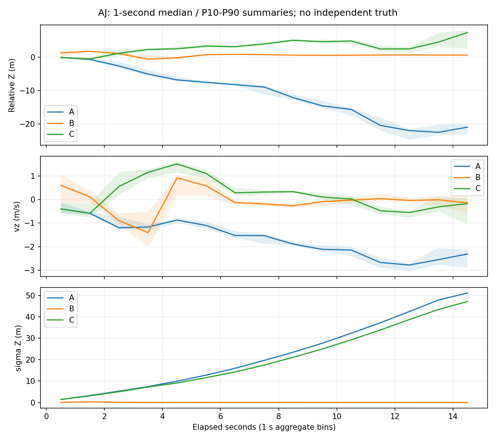

# Height and actual vertical state behavior

No NDT Z channel enters C. The observation has no direct Z/vz/bias columns, but full P and lever/attitude sensitivities make indirect corrections unavoidable. Maximum actual LiDAR dZ is0.310943m and |dvz|0.160987m/s. The largest actual vertical-speed update decomposes into signed contributions from X,Y,yaw innovations: +0.059187,+0.097674,+0.004126m/s, summing to+0.160987. It is not explainable by one P(vz,Z)/P(Z,Z) scalar because no Z innovation was fused.

The largest *proposed* |dvz| is25.81784m/s (signed−25.81784), with proposed dZ−200.929m. Its signed X/Y/yaw contributions are+1.99074,−22.74561,−5.06297m/s. Position and accel-bias guards reject it: actual dZ/dvz are zero. This is not a replayed velocity spike. Complete proposals, gains, signed decompositions and actual outcomes are retained privately.

C's Z state spans10.047m and ends+2.491m from the common initial Z. Its vz spans−1.4435..+1.6426m/s. These are estimated-state excursions, not measured altitude errors. No qualified independent height/old1D-Z truth is available. Final sigma Z is47.596m and sigma vz5.992m/s, indicating absent useful vertical observability under this model, rather than solved3D localization.

## Do not confuse LiDAR correction with total state jumps

The unchanged wheel observation also acts through full P. Its largest actual C update changes Z by4.13669m and vz by0.559931m/s. The largest100Hz C output increments are4.14785m in Z and0.605207m/s in vz. Therefore small *LiDAR* delta-vz does NOT establish a smooth or stable total vertical state. A has similar wheel maxima4.17699m/.550877m/s; B has .001999m/.005370m/s. This is direct update attribution, not proof of which branch is accurate.

With long-unobserved vertical position, wheel innovations can move that position substantially via propagated cross-covariance. C keeps the original wheel semantics and does not retrofit LiDAR guard limits onto it. NDT feedback changes the subsequent prior, so A/C similarity is evidence of a pre-existing model/observability issue, not a fully isolated causal proof.

The first C LiDAR event is rejected atomically, so its sigma Z remains1.077427m. At the first later accepted C event it changes2.463485→2.458299m, unlike B's first partial update's approximately1.077→.016m contraction. C avoids that specific unqualified geometry-information commit but trades it for poor height observability; this is not a validated3D remedy.

The figure publishes only15 scalar time-bin summaries, no raw sample trajectory, map coordinates or location track. Bands are within-bin P10/P90, not calibrated confidence intervals. B's narrow uncertainty is not evidence of accuracy.

## Direct evidence for lost retention through unobserved vertical coupling

Of87 engineering rejects,28 have planar proposal norm <=.5m and would satisfy the planar step length alone;66 have |dZ|>.5m (overlapping categories). The full3D position guard, not just planar pose mismatch, matters. At L079 immediately after the early acceptance run, NDT is OBJECTIVE_CONVERGED with fitness .109817. Innovation is only [−.03807m,−.09770m,+.005628rad]. Proposed XY is [−.003220m,−.008952m], but proposed Z is−.551458m and vz−.198604m/s. Original3D step safety rejects the entire transaction. Its signed Z contributions from X/Y/yaw are−.074410,−.487417,+.010369m; prior sigma Z is8.527m.

This is a concrete loss mechanism even without a direct Z observation and without requiring a demonstrably wrong NDT peak. It does not prove that the implied Z correction is physically correct or wrong; it proves why this actual Kalman proposal was rejected. Later NDT failures and weak fits coexist. Do not clip the vertical increment or delete its covariance crosses to make the planar observation pass.
