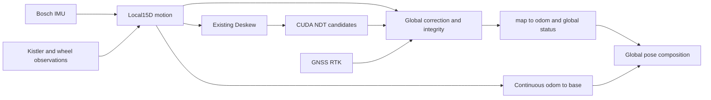

# Proposed NDT-centric architecture

Recommend B: retain CUDA-NDT and current ROS2/Deskew chain; local15D motion service, independent global correction service and source integrity manager. No FAR-LIO GICP/LIO replacement.

Local state x=[p,v,R,bg,ba] retains full15D P and physical inertial/velocity observation Jacobians. Bosch supplies propagation, not absolute position. Kistler observes calibrated velocity components at its sensor reference point; do not silently turn scalar speed into3D no-slip velocity. Wheel speed is a conditional body-forward motion source with scale/slip diagnostics and validated lever/angular-rate treatment. Kistler and wheel may disagree or share model errors; avoid counting a derived fused speed alongside its parents. No new nonholonomic/zero-vz constraint without vehicle evidence.

GNSS/RTK provides timestamped antenna position, fix status and datum-qualified uncertainty; RTK fix does not imply zero map datum error. Heading only from actual heading hardware or separately qualified motion-based model, never assumed from a single position fix. NDT supplies map-frame pose hypotheses and support/subspace/ambiguity evidence; IMU prediction is not a second absolute observation.

At matching timestamp τ: Cτ=T_map_base(candidate,τ) inverse(T_odom_base(τ)); global output at t is C_t T_odom_base(t). Both transforms use the SAME base/reference origin, handedness and calibration version. A global rotation change also changes expressed map-frame velocity; do not differentiate global pose across jumps or call it a physical acceleration. Publish local velocity separately, rotate it with clear semantics if needed. TF has one owner per edge; global position jumps are explicit events.

Global correction state maintains hypotheses, last accepted anchor/time, source health, subspace and uncertainty provenance. During lost anchors: retain last correction only as coasting with growing/unknown global uncertainty, not healthy fixed localization. Ambiguous candidates do not overwrite confirmed relation. Independent GNSS recovery can reanchor translation; yaw/height remain unavailable unless observed. Delay handling uses local history at τ and a bounded repropagation/retiming policy; never combine a stale NDT pose with latest odom.

Correlation is central: local motion seeds NDT and Deskew; C and local pose share errors. For perturbations e_g=Jc e_c+Jo e_o, Pg=Jc Pc Jcᵀ+Jo Po Joᵀ+Jc Pco Joᵀ+Jo Poc Jcᵀ. Dropping Pco is not justified. Initial service reports conditional diagnostics and UNKNOWN/UNCALIBRATED global covariance, not invented accuracy. A future joint delayed-state model can retain these cross terms. Covariance intersection is only an option if each marginal is already conservative and frames/times match; it cannot repair an uncalibrated NDT marginal. Multimodal output needs hypotheses, not one Gaussian.

Default feedback: global relation may seed search and drive a separate global display/planner channel; it cannot inject into local p/v/bias or odom/Deskew history. This breaks full probabilistic optimality and forfeits map-aided bias observability, deliberately. Any optional global-to-local feedback is a new experiment requiring joint correlation model, observability analysis, injection/reset and independent reference checks. Layering does not stop local vertical drift or AJ wheel-induced Z updates.

Speed policy: FAR-LIO stationary bias update (<.4m/s) and speed-dependent tire-radius interpolation have SOURCE evidence, not target-vehicle validity. No evidence supports switching weights by speed alone. At low speed heading from position differencing is weak; at high speed slip/timing/lever effects need validation. Select on health, innovation, support and validated physical model in every regime. Target-specific high/low-speed acceptance thresholds remain UNVERIFIED.
