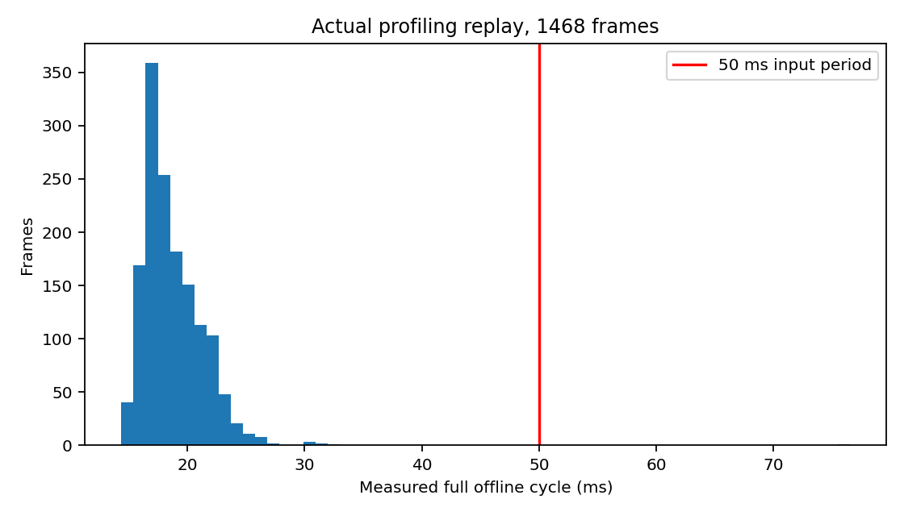

# AY离线性能资格

XY原始单圈后推进处理段P50/P95/P99/max：14.668/18.628/20.149/58.287ms；连续三圈16.810/21.346/25.727/196.182ms。CUDA-NDT本身单圈P95约3.13ms，并非主要长尾来源。启动预热与逐帧匹配分开，Target没有逐帧重建。

原AR start计时点位于传感器推进之后，因此上述数值不含该部分，不能称为完整端到端。补充真实1468帧XY周期插桩，计时点在传感器推进前至日志输出后：P50/P95/P99/max为18.122/23.095/26.069/76.524ms；1/1468周期超过50ms。完整算法逐帧seed/P/NDT/K/delta与XY原运行最大差异0。插桩本身增加开销，没有修改时钟、丢慢帧或扩大500ms历史缓存。

一次较早的独立插桩单圈，最大60.829ms处理段包含44.915ms二代GC；完整周期补测记录GC事件与inclusive模块计时于私有runtime_probe.json。历史三圈196ms事务没有同步GC证据，不能把它全部归因于GC。离线CPU调度/序列化/回溯仍有长尾。没有实施关闭GC或声称消除最坏延迟。

模块计时为inclusive，不能把P95相加得到端到端P95。补测周期峰值RSS约619.9MiB。光学correct与回溯分别计时；所有明细分位数见results/aggregate.json。模型Header到complete年龄包含原记录到达/点云窗口和计算近似，不是物理ROS发布时间；其模型可能漏掉未计入阶段，不能证明在线队列期限。

离线平均/多数周期有20Hz计算余量是VERIFIED；硬20Hz时限FAILED，ROS2端到端20Hz与本地100Hz输出NOT_VALIDATED。三圈无历史覆盖失败并不证明真实队列不存在积压。生产部署NO-GO。
