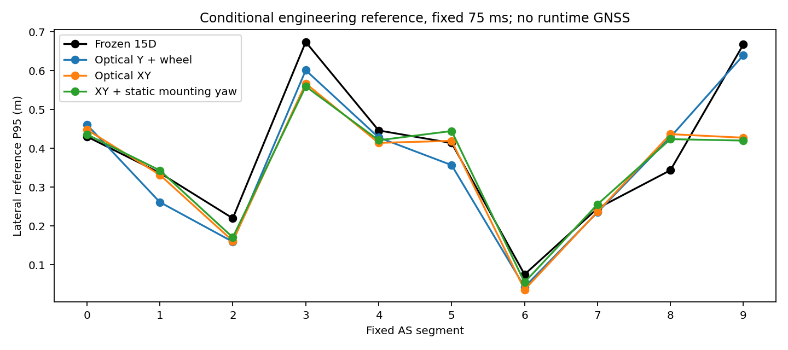
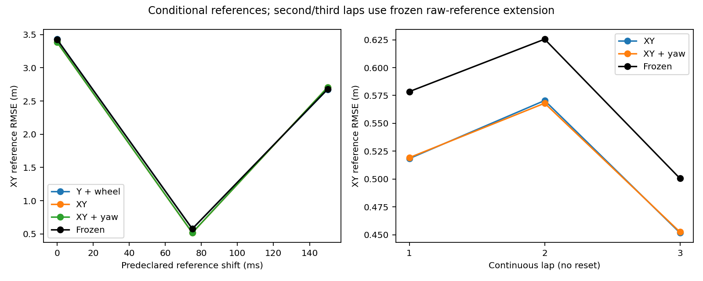

# AY真实闭环结果与资格

所有误差均为固定转换/杆臂/原生Header下的GNSS **工程参考差异**，不是认证真值。候选运行不读取GNSS。未调整NDT100、Q或FitnessR。

## 完整执行

L、XY、C各自完成1468帧73.35秒单圈，以及4134帧206.65秒连续三圈；三圈从同一合法初始条件持续运行，不逐圈重置。六组主要运行全部输入处理、全部NDT收敛、全部完整SO(3)观测进入滤波器。没有历史NDT最终位姿作为候选观测输入。

原版模式40帧重新CUDA匹配与AR对应的seed/P/NDT/delta/K最大差异全部为0；XY全圈性能插桩重跑对应1468帧这些量也全部为0。说明恢复的原版路径以及诊断插桩没有改变该次算法结果，不等于完整ROS2在线时序等价。

## 同一1197帧工程参考，75ms

| 方案 | XY RMSE m | 右弯3横向P95 m | 右弯9横向P95 m | 正常5横向P95 m | 正常8横向P95 m |
|---|---:|---:|---:|---:|---:|
| 冻结15D | 0.577097 | 0.673964 | 0.667541 | 0.413730 | 0.343576 |
| 旧EKF历史参考 | 1.137471 | 0.419956 | 0.269963 | 1.064879 | 0.616239 |
| L_lap | 0.576070 | 0.601210 | 0.639858 | 0.356751 | 0.428960 |
| XY_lap | 0.516665 | 0.567103 | 0.427361 | 0.419286 | 0.436548 |
| C_lap | 0.517521 | 0.559441 | 0.419980 | 0.444548 | 0.423636 |

XY相对原版全圈工程XY RMSE改善10.47%，右弯3/9横向P95分别改善15.85%/35.98%；但正常8从0.343576升至0.436548m，约27.1%退化。不能宣称整体修复成功。正常5也有较小退化，完整分段0–9与P50/P95/max见脱敏JSON。

## 预先固定的参考时间敏感性

| GNSS假设 ms | 原版XY RMSE m | XY候选 m |
|---|---:|---:|
| 0 | 3.427959 | 3.385751 |
| 75 | 0.577097 | 0.516665 |
| 150 | 2.677148 | 2.706107 |

150ms下排序反转；没有选择最有利的时间进行算法调参，也不能把75ms结果认证为真实精度优势。

## 连续三圈

| 圈次 | 原版XY RMSE m | XY候选 m | C候选 m |
|---|---:|---:|---:|
| 1 | 0.578498 | 0.518385 | 0.519244 |
| 2 | 0.625524 | 0.570490 | 0.568052 |
| 3 | 0.500552 | 0.451743 | 0.452494 |

这里采用冻结的原始GNSS参考扩展覆盖各圈；第一圈1204个有效样本，与历史1197公共mask指标有细小差别。后两圈是连续时间验证，不是独立同分布样本。三圈均未数值失锁，但不能据此证明每帧正确峰。

## 状态与反馈机制

XY三圈P最小特征值4.99e-07，对称性最大误差0；保留完整15D交叉项。XY单圈横向单位创新增益均值0.0874，并未通过提高NDT增益获得改善。所用状态/工程P数值稳定，不代表统计一致性。

XY单圈7357个唯一光学观测中7352接纳，5个因状态资格拒绝；三圈20687个中20672接纳，15个拒绝。重复回溯执行的日志修订按message_id去重统计，不当作新独立信息。报告中的测量R仍是未经标定的保守工程假设。

## 仍然失败的正常段8

相同原生时刻，原版NDT横向参考P95为0.461326m，XY自身NDT为0.4631m，两者接近；XY先验/后验为0.4362/0.4365m。此处不是简单把增益加大就能跟随更接近工程参考的NDT。冻结原版后验0.3436m反而比两组NDT更接近该参考。当前证据无法判定原版是在补偿共同系统误差，还是候选引入了真实运动偏差。

同一仪器未融合光学样本的横向速度残差RMSE在段8由0.3598降至0.3208m/s，而GNSS横向位置差异恶化；这反驳了“光学速度一致性更好就一定位置更准”。未融合样本与已融合样本相关，不是独立验证真值。右弯3同类残差由0.5617降至0.5310m/s，支持运动约束参与改善，但不足以认证物理根因。

C增加静态安装角估计仍未解决段8，全局RMSE也不优于XY，正常5更差。没有按赛道位置切换策略或继续搜索R/Q倍率。真实困难弯道改善是CONDITIONAL；整体无退化要求是FAILED。

## 可用性与安全界限

本轮没有增加正确峰标签、独立GNSS物理标定、真实轮胎边界或现场ROS2测试。100%收敛/接纳只说明实现运行完成，不能推导100%正确匹配或安全GO。新候选改变了自身source与匹配初值，保留了实际匹配差异，均不是固定历史观测反事实。
