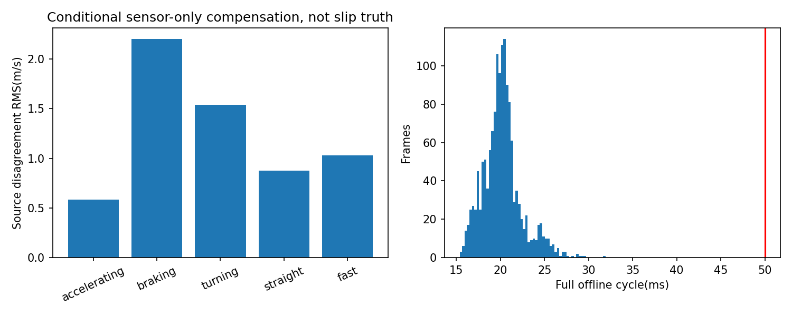

# Fault and timing evidence

## Predeclared injection, not real hardware failures

Fixed origin is first selected extraction Header plus1s, unrelated to corner/reference outputs. Drop all optical events at offsets20–22s; add15m/s to raw optical x with status left valid at35–35.5s. Same S algorithm, data, own predictions/CUDA and geometry; no reset or noise tuning. Entire1468-frame actual point-cloud loop completes and NDT updates1468/1468.

-2s dropout: 191 wheel updates,0 optical updates inside interval. Optical reaccepted 0.109s after data return.
- Valid-status gross corruption: 50 wheel updates,**0 optical updates** inside interval. Optical reaccepted 0.201s after corruption ends; recovery includes dynamic-change evidence and fresh-data dwell.
- Original source selection has a100ms silent-expiry grace: no synthetic optical measurements are generated during that grace. Bad status/jump exits active immediately; it does not wait for the grace to expire.
- Fault-versus-no-fault global posterior difference P95/max 0.058/0.141m is a relative difference, not real positioning error. NDT remains healthy in this test. Long simultaneous LiDAR+optical failure, modest/gradually varying bias and physically certified fault coverage are NOT_VALIDATED.

## Actual timings

S complete-cycle profiling1468 frames includes sensor advance, processing and output logging: P50/P95/P99/max 20.105/24.712/26.678/31.916ms, 0/1468 over50ms. All1468 seed/P/NDT/K/delta exactly match unprofiled S. Peak RSS 619.3MiB. Module timings are inclusive; their P95s must not be added to manufacture end-to-end latency.

However continuous S three-lap post-ingest processing has max181.758ms, M205.023ms. Therefore this one favourable profiling replay does not establish hard50ms deadlines. S three-lap modeled Header-to-complete maximum224.286ms is an offline age model, not real ROS callback/publication time; original timer excludes pre-advance, so it is a lower-scope processing number. Full three-lap source diagnostics add actual JSONL I/O and CPU cost, not hidden or subtracted time. GPU matcher remains a few milliseconds; no live CPU utilization/ROS queue measurement was made.

Actual ROS2 endpoint,100Hz publication/scheduling and hard20Hz qualification are NOT_VALIDATED. Retained offline long tails mean no general realtime PASS. No history expansion, slow-frame deletion, fake completion clock or GC-disable qualification claim. Full actual timing/source statistics and fault decisions are in aggregate.json/private logs.

