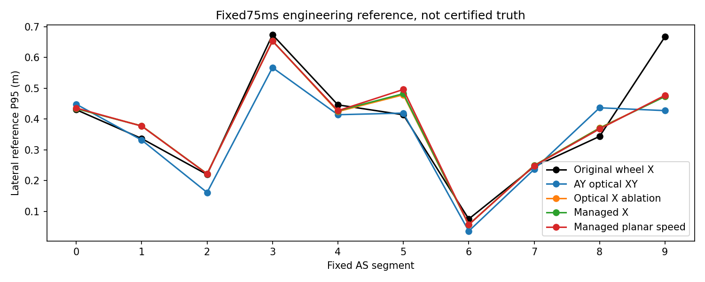
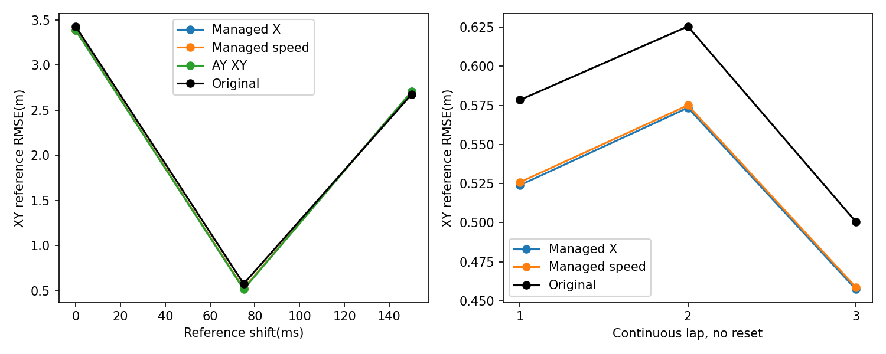

# AZ真实闭环结果

结论：来源管理和所测回退机制有效执行；**整体定位修复FAILED**。所有误差都是固定GNSS工程参考差异，不是认证真值。

## 全部实际执行

| 方案 | 单圈处理/接纳 | 连续三圈处理/接纳 |
|---|---:|---:|
| X单轴消融 |1468/1468|不作为最终候选，未执行三圈|
| M管理前向 |1468/1468|4134/4134|
| S管理平面速度 |1468/1468|4134/4134|
| S受控故障 |1468/1468|NOT_EXECUTED|
| S完整周期插桩 |1468/1468|NOT_EXECUTED|

M/S均使用自身状态、原始三LiDAR/IMU/loop44轮速、真实CUDA Deskew、原map0105、NDT100及完整15D回溯。单圈73.35s，连续三圈206.65s，不逐圈初始化。原版A及AY-B复用冻结真实结果，不重复运行或声称为新实验。X40/M40_fixed/S40等定向CUDA窗口和最终代码S40_final也保留。

## 相同1197帧，固定75ms

| 方案 | XY RMSE m | 右3横向P95 m | 右9横向P95 m | 正常5横向P95 m | 正常8横向P95 m |
|---|---:|---:|---:|---:|---:|
| 原版15D | 0.577097 | 0.673964 | 0.667541 | 0.413730 | 0.343576 |
| AY光学XY | 0.516665 | 0.567103 | 0.427361 | 0.419286 | 0.436548 |
| X单轴消融 | 0.519448 | 0.653923 | 0.473463 | 0.478793 | 0.371084 |
| M管理前向 | 0.522311 | 0.653829 | 0.473088 | 0.482359 | 0.370287 |
| S管理平面速度 | 0.524227 | 0.653423 | 0.477049 | 0.495970 | 0.367741 |
| 旧EKF历史 | 1.137471 | 0.419956 | 0.269963 | 1.064879 | 0.616239 |

M/S降低了AY在段8的退化，但不能保住AY右弯3/9的全部收益，正常5比原版和AY更差。X→M主要验证来源管理差异，M→S验证方向不敏感速度模型；不能把降低某个弯道差异当作整体通过。所有分段0–9、纵/横向P50/P95/max、Yaw和Z差异均保留在aggregate.json，没有改mask或只发布成功帧。

## 连续三圈，不重初始化

| 圈次 | 原版XY RMSE m | AY XY m | M m | S m |
|---|---:|---:|---:|---:|
| 1 | 0.578498 | 0.518385 | 0.523983 | 0.525889 |
| 2 | 0.625524 | 0.570490 | 0.573508 | 0.575075 |
| 3 | 0.500552 | 0.451743 | 0.457425 | 0.458697 |

使用冻结原始参考扩展：各圈实际有效样本/覆盖见JSON。第一圈1206原始参考样本与历史1197公共mask不同，数值略有差别。连续三圈数值稳定、没有失去LiDAR更新，但不表示每个匹配峰都正确，也不表示后两圈是独立统计样本。

## 参考时间敏感性

| 假设ms | 原版XY RMSE | AY | M | S |
|---|---:|---:|---:|---:|
| 0 | 3.427959 | 3.385751 | 3.387941 | 3.390302 |
| 75 | 0.577097 | 0.516665 | 0.522311 | 0.524227 |
| 150 | 2.677148 | 2.706107 | 2.705831 | 2.703672 |

150ms下原版仍更接近该参考；不能据75ms降低RMSE认证绝对精度或选择最有利偏置。

## 速度来源及状态反馈

M/S无故障三圈各约20500个光学更新、189个轮速更新，15个光学资格拒绝，172个恢复等待；精确计数以去除回溯修订后的JSON为准。重建历史内重复调用不是新的观测。来源变化依据实时数据/状态/时效，与段号无关。没有同时独立融合轮速X和Kistler X/内部修正速度。

M三圈P最小特征值5e-07，S为5e-07，对称性误差均0。所有15D交叉项保留。速度更新引起的实际位置/速度/姿态/Bias增量范数统计在source字段，不以状态总运动增量冒充观测修正。P数值稳定不是统计一致性。

同一原生时刻的先验/NDT/后验和差异保存在私有evaluation/transactions中，公开保留匹配前后反馈统计。实际新增模型改变自身seed、source及NDT结果；没有使用历史最终匹配位姿作为候选输入。

## 来源不一致和实测动态

条件性参考点补偿后，轮速与光学差异RMS：加速0.584、制动2.202、弯道1.537、直道0.875m/s。114个>5m/s风险样本均在制动组，不等于114次已认证轮胎打滑。各组时间差/残差/样本相关性和固定时延敏感性见JSON。

52158条原始四轮消息四通道均非零且有限。前后轮相对差异P5/中位/P95约−0.76%/0.87%/2.83%，极端差异还可能含转向、半径、协议和时间影响。它们未重新注入滤波器或用于拟合轮径。没有对轮速高低速可靠性作普遍断言。
