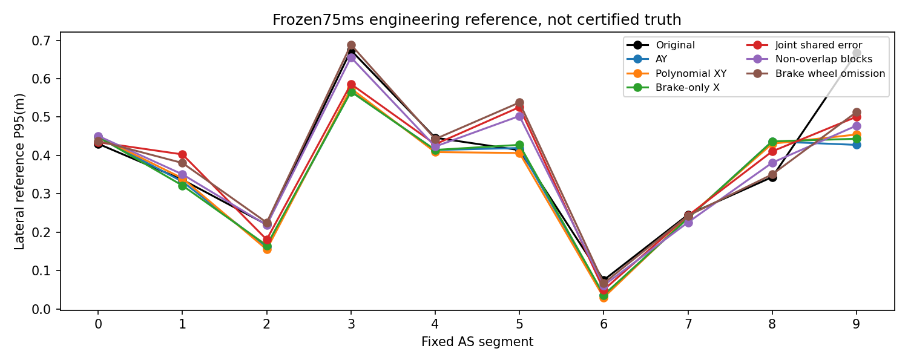
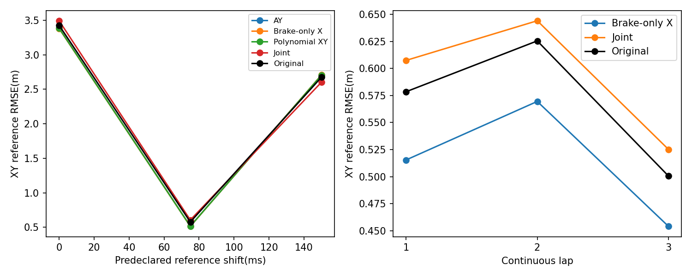
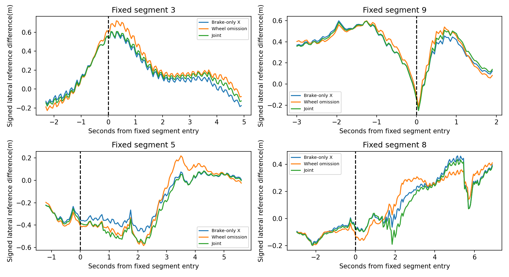
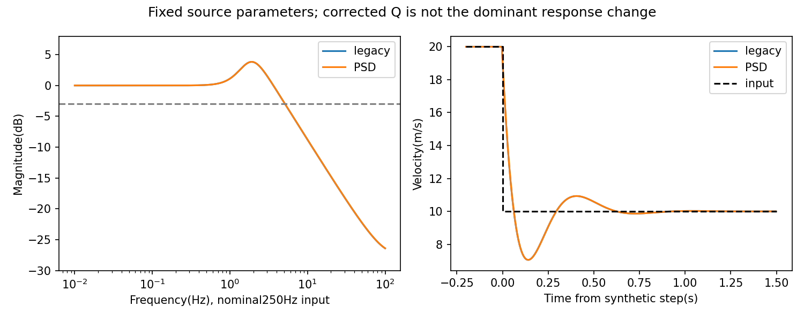

# BA实际闭环结果与制动入弯归因

**本轮未通过整体修复验收。**完成了速度动态前端、联合共享误差模型及真实单因素干预；不是固定历史NDT观测重放。所有误差为固定GNSS工程参考差异，不能作为认证真值。

## 全部实际运行

| 方案 | 1468帧单圈 | 4134帧连续三圈 |
|---|---:|---:|
| F 全XY因果滤波 |1468/1468接纳|NOT_EXECUTED|
| B 仅减速X前端 |1468/1468|4134/4134|
| J 15D+共享光学误差联合估计 |1468/1468|4134/4134|
| C 非重叠块估计 |1468/1468|NOT_EXECUTED，单圈已失败|
| W 原版减速轮速省略诊断 |1468/1468|NOT_EXECUTED，非默认候选|
| B最终保护版本正常周期插桩 |1468/1468|NOT_EXECUTED|
| B原始异常注入 |1468/1468|NOT_EXECUTED|

连续三圈206.65s，无逐圈重置；单圈73.35s。原始三LiDAR、真实CUDA Deskew、map0105、CUDA-NDT100、完整SO3、各自状态/P/匹配初值及延迟回溯。F40/J40/C40前缀也真实执行。所有拒绝/事件保留，不以接纳或收敛证明正确峰。

## 同一1197帧、固定75ms

| 方案 | XY RMSE | 右3横向P95 | 右9横向P95 | 正常5横向P95 | 正常8横向P95 |
|---|---:|---:|---:|---:|---:|
| 原版 | 0.577097 | 0.673964 | 0.667541 | 0.413730 | 0.343576 |
| AY | 0.516665 | 0.567103 | 0.427361 | 0.419286 | 0.436548 |
| AZ管理前向 | 0.522311 | 0.653829 | 0.473088 | 0.482359 | 0.370287 |
| F_lap | 0.515545 | 0.574281 | 0.454436 | 0.406281 | 0.430425 |
| B_lap | 0.513650 | 0.566029 | 0.443470 | 0.427491 | 0.436553 |
| J_lap | 0.605859 | 0.585953 | 0.500611 | 0.525752 | 0.410507 |
| C_lap | 0.619609 | 0.655390 | 0.477533 | 0.502614 | 0.380949 |
| W_lap | 0.620765 | 0.688467 | 0.512890 | 0.537858 | 0.350454 |

单位m。B全局只比AY改善约0.58%，不能当作稳健真实精度优势。右3大致保留，右9变差，正常8未改善。J和C并非“更数学化便更准确”，其整体退化明确。正常全部固定0–9、XY/纵向/横向/Yaw/Z的P50/P95/max及有效覆盖见JSON，不只展示困难弯。

## 三圈与参考敏感性

| 圈次 | 原版XY RMSE | AY | B | J |
|---|---:|---:|---:|---:|
| 1 | 0.578498 | 0.518385 | 0.515406 | 0.607469 |
| 2 | 0.625524 | 0.570490 | 0.569532 | 0.644160 |
| 3 | 0.500552 | 0.451743 | 0.454009 | 0.525178 |

各圈使用冻结原始参考扩展，第一圈1204有效样本不同于历史1197公共mask，不能混用统计。B第三圈也未优于AY；J每圈均劣于原版。数值/匹配连续稳定与精度改善分开判定。

| GNSS假设ms | 原版XY RMSE | AY | B |
|---|---:|---:|---:|
| 0 | 3.427959 | 3.385751 | 3.382503 |
| 75 | 0.577097 | 0.516665 | 0.513650 |
| 150 | 2.677148 | 2.706107 | 2.709023 |

150ms仍反转原版/B的排序；无参考时间搜索。

## 真实干预因果证据

B有1987个单圈光学事件使用减速专用X处理；第一次干预前，4个已完整完成采集/处理的帧，其seed/P/NDT与AY逐项完全一致。干预后自己的速度、状态、Deskew和匹配逐步变化。这证明算法差异由已声明干预引入，不证明更接近物理真值。用完成/采集边界而非只用Header，避免扫描跨越状态时刻的假因果。

B固定先验局部反事实去除附加前端P_vv，最大位置/速度增量直接差异约2.19e−7m/6.87e−7m/s；这不是重跑轨迹，不证明整个非线性匹配反馈完全不受微小协方差改变影响。

W在同一原版A中省略减速代理期间轮速，XY从0.577升至0.621m，右3从0.674升至0.688m；右9改善但正常5明显恶化。因此不能把全部制动轮速视为有害。W不排除部分114个风险样本确有问题，也不能唯一证明轮速物理正确。

固定右3/9与正常5/8窗口为AS分段前3s、后.5s，未按输出挑窗口。B在右3/9的先验/NDT/后验横向P95约.604/.271/.566和.447/.423/.443m；正常8约.436/.463/.437m。正常8问题没有因速度前端改变而消失。当前地图观测/预测/参考的共同偏差仍不能唯一归因，低fitness不能给正确峰标签。

## 前端动态、状态和协方差

250Hz固定参数下，新旧Q的−3dB点均约5.14Hz；2Hz增益约1.548，存在放大而非单纯降噪。10m/s理想阶跃t50≈24ms、t90≈52ms、约2.95m/s过冲；这是极端合成响应。10m/s²合成减速斜坡最大速度差约.260m/s。不能用一个固定群延迟概括此动态。实际原始减滤波X/Y RMS约.498/.499m/s，不等于滤波真实误差。

B/J三圈P最小特征值分别4.99e-07/4.99e-07，对称性误差0；完整物理15D交叉项及J的2维共享误差交叉项均保留。220项测试通过；FD、独立Q积分、Joseph/reset、延迟等价、块时间/PSD、单因素省略、原始异常保护均有测试。数值正确不代表统计一致性。

J估计光学offset的单圈均值约X−.144/Y+.036m/s，属于模型内共享误差状态；它可能吸收轮速、地图、时间或安装误差，不能称物理标定。尽管参数估计稳定，定位指标更差。估计bias或得到正定P并不是解决问题。
