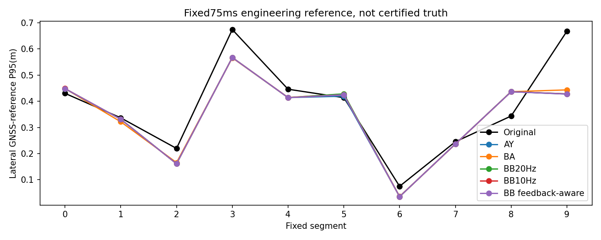
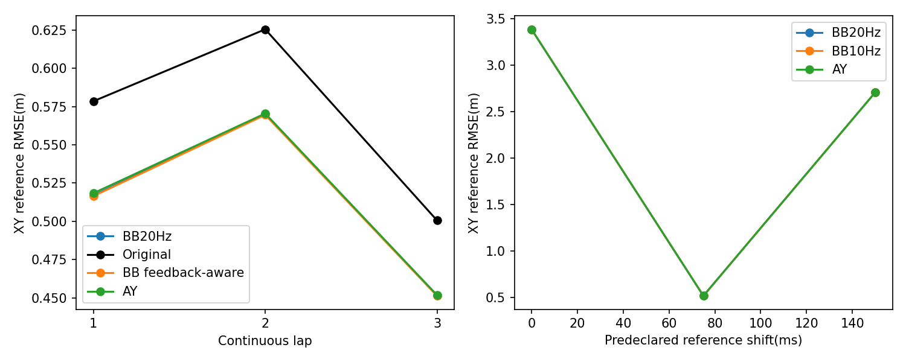
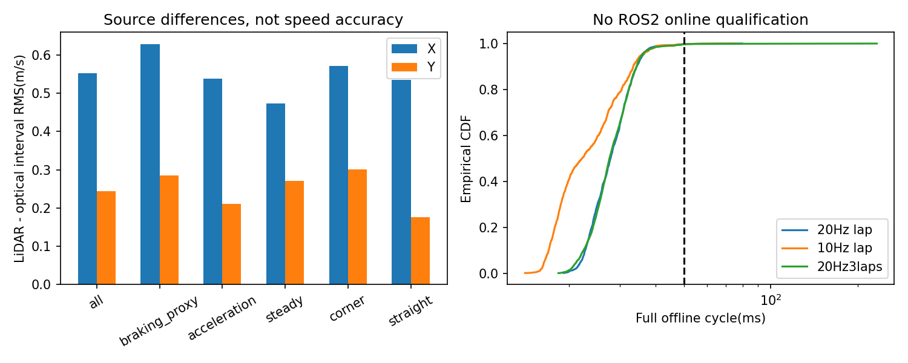

# BB实际测速与闭环结果

**整体修复FAILED。**所有精度数字是冻结GNSS工程参考差异，不是认证真值。测速进入运行链的方式是下一帧NDT平移初值辅助，没有新增独立速度Kalman观测。

## 实际执行

| 运行 | 实际帧数/全部NDT接纳 | 条件性测速可用帧 | 初值辅助帧 |
|---|---:|---:|---:|
| P_lap | 1468/1468 | 1411 | 1409 |
| L_lap | 1468/1468 | 703 | 703 |
| P_multilap | 4134/4134 | 3966 | 3962 |
| P_final_multilap | 4134/4134 | 3966 | 3962 |
| P_fault | 1468/1468 | 1373 | 1371 |
| R_lap | 1468/1468 | 1408 | 1406 |
| R_multilap | 4134/4134 | 3960 | 3956 |

P40/M40/R40各40帧；M40关闭辅助时全部seed/P/NDT/delta与AY最大差异0。P_final三圈前1468帧与P单圈seed/P/NDT/K/delta最大差0。连续三圈206.65s，无重置；每个单圈73.35s。P/R都使用自己的原始三LiDAR、真实Deskew、自己的IMU/光学/轮速、自己的相对配准初值和实际CUDA-NDT/完整15D历史反馈。L为10Hz测速单圈成本消融，未执行L三圈。没有把固定历史匹配当新候选反馈。

## 同1197有效样本、固定75ms

| 方案 | XY RMSE | 右3横向P95 | 右9 | 正常5 | 正常8 |
|---|---:|---:|---:|---:|---:|
| 原版 | 0.577097 | 0.673964 | 0.667541 | 0.413730 | 0.343576 |
| AY | 0.516665 | 0.567103 | 0.427361 | 0.419286 | 0.436548 |
| BA最佳B | 0.513650 | 0.566029 | 0.443470 | 0.427491 | 0.436553 |
| BB-P | 0.515194 | 0.567096 | 0.428216 | 0.428398 | 0.436608 |
| BB-L10Hz | 0.516396 | 0.567109 | 0.428067 | 0.424532 | 0.436406 |
| BB-R反馈运输 | 0.514720 | 0.567013 | 0.427601 | 0.424615 | 0.436173 |

单位m。全部0–9段的纵/横向P50/P95/max、XY/Yaw/Z、先验/创新/实际更新和P见聚合JSON。R比AY单圈RMSE只约0.38%更低，未解决正常8相对原版的退化；正常5还稍差。不能称统计显著或真实精度改善。

## 连续三圈与时间敏感性

| 圈 | 原版 | AY | BB-P | BB-R |
|---|---:|---:|---:|---:|
| 1 | 0.578498 | 0.518385 | 0.516929 | 0.516456 |
| 2 | 0.625524 | 0.570490 | 0.570131 | 0.569563 |
| 3 | 0.500552 | 0.451743 | 0.451443 | 0.451208 |

三圈扩展第一圈1204样本，不与1197公共mask混用。R各圈比AY差异只有毫米级，不能以此证明长期精度更优；只是闭环数值/匹配连续无失锁。

| 参考时间ms | 原版XY | AY | BB-P | BB-R |
|---|---:|---:|---:|---:|
| 0 | 3.427959 | 3.385751 | 3.384027 | 3.383706 |
| 75 | 0.577097 | 0.516665 | 0.515194 | 0.514720 |
| 150 | 2.677148 | 2.706107 | 2.707722 | 2.707940 |

150ms依然使原版排序反转；未选取最优延迟。

## 测速信息与限制

| 区间 | 全部扫描对 | 单对诊断合格 | 与光学X/Y差异RMS | X最大来源差异 |
|---|---:|---:|---:|---:|
| 50ms | 1467 | 1450 | 0.984/0.382m/s | 9.166m/s |
| 100ms | 1466 | 1456 | 2.358/0.245m/s | 65.356m/s |

这不是正确率；即使H合格且收敛也有大异常。8个按传感器差异固定选取的冻结扫描对，各运行名义/±1mX/±.5mY/+.03radYaw/反向，共56次；竞争解纵向速度跨度最大约65m/s，未知哪个为正确峰。无GNSS错误峰标签，不计算检测准确率。

| 工况代理 | LiDAR−原始光学RMS X/Y | LiDAR−滤波光学RMS X/Y | IMU预测−原始光学RMS X/Y |
|---|---:|---:|---:|
| all | 0.553/0.245 | 0.559/0.246 | 0.148/0.122 |
| braking_proxy | 0.628/0.286 | 0.638/0.285 | 0.191/0.122 |
| acceleration | 0.538/0.210 | 0.538/0.213 | 0.128/0.120 |
| steady | 0.474/0.271 | 0.494/0.272 | 0.132/0.125 |
| corner | 0.571/0.301 | 0.578/0.300 | 0.127/0.115 |
| straight | 0.535/0.176 | 0.540/0.181 | 0.166/0.128 |

这些是同一候选条件性筛选后的区间来源差异，非独立测量误差；IMU预测已受光学融合影响，其小差异不能作为优于LiDAR的独立真值。减速由自身IMU轴向加速度<−1m/s²定义，弯道由|wz|>.1rad/s定义，不是制动器或位置标签。全时序图和完整速度留私有目录。跨帧相关统计见JSON，不能将重叠扫描对当独立观测。

## 初值和真实反馈

- P_lap：对实际应用辅助的帧，约62.8%的初值到自身最终NDT解XY距离减小；P95由0.4104m变为0.3998m。
- R_lap：对实际应用辅助的帧，约61.2%的初值到自身最终NDT解XY距离减小；P95由0.4101m变为0.4018m。
- R_multilap：对实际应用辅助的帧，约63.6%的初值到自身最终NDT解XY距离减小；P95由0.4892m变为0.4977m。

这只说明优化初值与终点的距离，不能证明终点正确；R三圈P95反而稍增，改善并不统一。新增辅助改变真实匹配/后验，但原始初值已在正常收敛域内，所以只有小数值收益，没有解决弯道估计结构。测速本身的采样噪声、有限区间动态和共享误差仍显著。

## 实际性能与故障

| 运行 | 完整周期P50/P95/P99/max(ms) | >50ms帧 | 测速前端P95(ms) |
|---|---:|---:|---:|
| P_lap | 27.88/36.09/41.88/79.56 | 5 | 12.38 |
| L_lap | 22.24/35.67/40.49/74.26 | 4 | 12.12 |
| P_final_multilap | 27.63/35.70/44.69/232.61 | 14 | 11.93 |
| R_lap | 26.72/34.75/45.63/67.86 | 4 | 11.89 |
| R_multilap | 27.84/36.17/45.80/227.78 | 15 | 12.33 |

R三圈测速区间中点至记录处理完成的模型年龄P50/P95/max约131.6/142.2/303.3ms；包含区间长度、原始到达和实际计算，不等于ROS发布时间认证。速度初值提示仅用上一对当前已完成的结果，未使用未来点云。各模块分位数不相加。

指定[20,22)s测速输出不可用注入：40帧、区间内合格测速0，恢复后0.000196s首次重新取得条件性测速；完整1468帧NDT接纳。没有强制速度或伪位姿填补；Kistler/轮速/IMU/地图定位保持。独立服务管道失败和过期提示有测试；此次实际完整运行没有服务故障，不将数值测试冒称实际服务崩溃实验。

234项测试通过，BB新增14项。SE3 log/exp、逆变换、完整杆臂、单位与耦合、过期/未来/差速域、原状态不变、服务退出和反馈扣除均验证。完整原估计器字节不变；Joseph/reset和15D数值资格沿用回归并由真实P对称/最小特征值复核。噪声和统计一致性仍NOT_VALIDATED。独立编译9对pose差8.88e−16、H差5.96e−7为浮点归约差异，非新算法。
