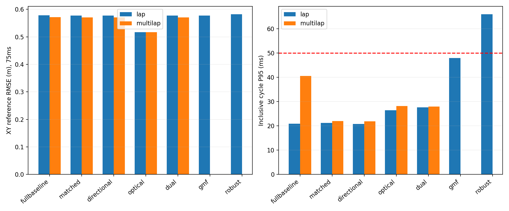

# Inclusive performance comparison

Serial configurations; real CPU small_gicp and CUDA-NDT/deskew. Within a first-frame candidate request, CPU/GPU backends may overlap; two established branches have independent deskew and are subsequently processed in sequence. Reported component times overlap in the first case and must not be summed as wall time. Inclusive cycle includes file IO and logging. No CUDA GICP was used. The startup field is service cache-warm time, not all process/validator initialization.

| Run | P50 | P95 | P99 | max | >50ms |
|---|---:|---:|---:|---:|---:|
| fullbaseline_lap | 16.80 | 20.88 | 22.48 | 33.18 | 0 |
| matched_lap | 16.82 | 21.16 | 25.36 | 118.42 | 3 |
| directional_lap | 16.55 | 20.81 | 22.99 | 129.32 | 3 |
| optical_lap | 20.59 | 26.37 | 31.07 | 133.38 | 8 |
| dual_lap | 20.05 | 27.61 | 34.48 | 76.77 | 3 |
| gmf_lap | 35.42 | 47.87 | 63.65 | 179.88 | 44 |
| robust_lap | 35.83 | 65.90 | 89.87 | 220.85 | 299 |
| fullbaseline_multilap | 17.04 | 40.56 | 67.75 | 208.53 | 117 |
| matched_multilap | 16.89 | 21.92 | 41.27 | 208.52 | 28 |
| directional_multilap | 17.30 | 21.84 | 38.43 | 210.68 | 28 |
| optical_multilap | 20.87 | 28.20 | 53.97 | 534.57 | 47 |
| dual_multilap | 20.27 | 27.94 | 37.08 | 263.42 | 22 |

All values are milliseconds. Complete CUDA-NDT, GICP service, deskew, geometric validation, delayed-update/repropagation, GMF and rollback distributions are in `aggregate_results.json`. Matching service wall includes its neighborhood/derivative/optimizer work; these binaries do not expose an independently separable neighborhood/Hessian/line-search timer for every path. Such missing decomposition is UNKNOWN, never reported as zero. GPU memory and CPU/GPU contention were not sampled continuously, so no resource-isolation guarantee is claimed.

Strict 50ms qualification requires every complete cycle, including recovery, to fit. A good P95 does not satisfy that condition. Source-history archival allows offline processing of all raw scans despite backlog; it does not make late observations timely. Measurement history stays 500ms and expired observations do not enter the filter. Cold failures, user pause/interruption and pre-fix slow paths remain in the private logs and public failure inventory.

## Interpretation and resources

One observed baseline single lap has zero50ms overruns; its three-lap run has117. No candidate satisfies the complete test set's strict bound. P95 below50ms does not constitute a deadline pass. The benchmark includes Python replay, forensic native-cloud IO and a nearly-full NTFS volume; it is not production six-state timing or a lower bound on all GMF implementations. RESOURCE_SUMMARY.json supplies sampled whole-device GPU use and controlled-rerun process RSS/CPU, with interval and shared-page/lifetime-average caveats. Full initial GMF CPU memory was not continuously sampled.

Missing three-lap GMF/robust bars indicate failed incomplete runs, not zero error or zero latency. The50ms line is a deadline; these are P95 bars, and the max/overrun table remains the qualification criterion.
