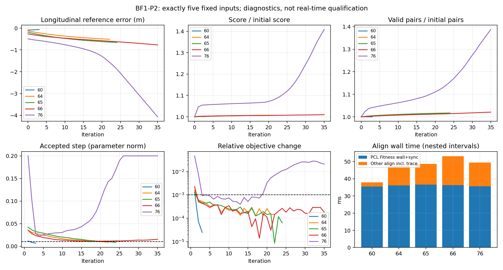

# Phase BF1-P2：五帧固定输入迭代与计时诊断

基线`6e43ecb0a53470f229e7d0882ccb4e7950ee14ec`，仅60/64/65/66/76各匹配一次，共5次、119条迭代记录。没有预热匹配、额外试探、57帧运行、15D回放或状态/P提交。五帧与BF1历史结果等价，原动态库完全复用，参数未变。**本阶段完成即停止。**

关键结论：

1. 64/65帧score每步上升、每步向不利纵向移动，分别累计−0.385164/−0.469280m，最后正常满足两条件连续两次。这是数值收敛与参考定位误差不一致的直接证据，不是GLL3反复回退。
2. 66帧目标相对变化已达标，但步长仍0.015232>0.01；76帧步长0.2、相对变化0.020851，均不达标。两者35步始终向不利纵向移动，不能简单加迭代次数。
3. **119步全部score上升、0次回退、0次方向反转、无本次可证实的两点震荡。** 关联身份未记录，关联集合周期切换仍UNKNOWN。
4. 76帧支持对数138573→192244（+38.73%），score+40.83%，但更偏离参考；支持增多不等于正确性。局部曲率也可能在偏移过程中增强。
5. **PCL Fitness墙钟约35.47–36.53ms，占align约68.3–93.6%。** 不是GLL3回退主导耗时。此项含同步等待，非纯GPU事件时间。不能据5帧trace声明20Hz或P95/P99通过。

[逐帧数值](FRAME_ANALYSIS.md)、[身份与等价性](IDENTITY_AND_EQUIVALENCE.md)、[计时](TIMING.md)、[证据边界及后续建议](CONCLUSION.md)、[失败与测试](TESTS_AND_FAILURES.md)、[复现](REPRODUCE.md)、[聚合原值](RESULTS.json)、[119行标量记录](ITERATION_METRICS.csv)、[清单](manifest.json)。完整6DoF轨迹、请求、Native协方差和原trace保存在工作卷私有目录，不在此公开原状态/输入载荷。

误差仅相对既有OXTS工程参考，不作为独立真值或协方差标定。参考只在匹配完成后的分析阶段读取，不进入Source、地图、Seed或优化过程。
