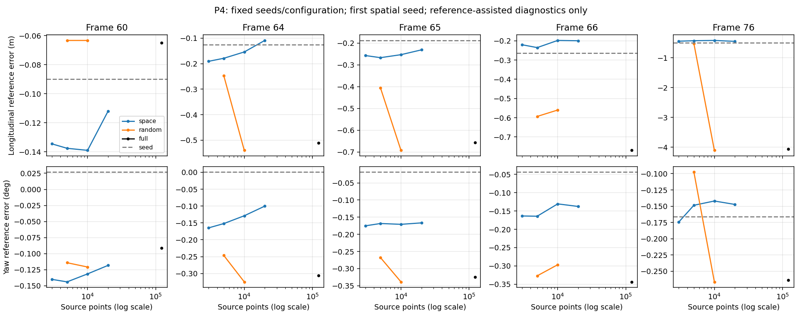

# Phase BF1-P4：Source点数与空间覆盖消融

批准基线`3c1c45e7f3accb7a29008642c192b84d88e2675d`，仅60/64/65/66/76。执行20次基础空间采样+2次FULL OFF补测+40次预置种子稳定性+10次随机对照=**72次新匹配**，另复用3帧P3 FULL。没有15D传播、R构造或状态/P提交，不修改目标、优化器或生产参数。

CONFIRMED：空间采样60组全部收敛，同N三种子的最大XY差0.082331m；但正常60帧反而更偏，不能声称普遍改善。76帧随机10000/FULL仍MAX_ITERATIONS，空间10000收敛且偏移明显减小，说明分布不能被总点数替代。空间排序Python原型约73–76ms，**本实现在线50ms NO-GO**，即使align很短。

[设计](SAMPLING_DESIGN.md)、[点数结果](POINT_COUNT_RESULTS.md)、[采样对照](SAMPLING_METHOD_COMPARISON.md)、[几何与失败](GEOMETRY_AND_FAILURE_ANALYSIS.md)、[性能](PERFORMANCE.md)、[A2RL迁移](A2RL_TRANSFER_ASSESSMENT.md)、[复现](REPRODUCE.md)、[结论](FINAL_CONCLUSION.md)。全部75行标量与覆盖分布见RESULTS.csv/RESULTS.json/COVERAGE.json，完整Native矩阵和请求仅私有保存。

当前停止，不实施A2RL采样修改、不优化采样器或增加匹配。五帧工程参考不足以认证全场精度或生产最优点数。
