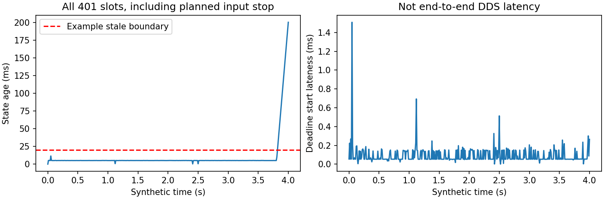

# 事件内核+只读100Hz输出原型

CONFIRMED：实现了研究级真实ROS2发布，而不是只设计timer。`high_rate_output.py::SnapshotStore`是原子不可变快照；`test_high_rate_ros.py`以原有15D/LegacyComparisonReplay驱动真实延迟事件。没有改估计内核或任何真实观测。

## 接口与原子性

估计owner完成一次事件（含整个rollback/replay）后，复制mean、完整15×15 P、state_time、last_imu、last_lidar及revision。检查P形状/有限/对称/PSD、均值有限、IMU不在state之后、当前提交不倒退。读者只读snapshot；从不predict/correct，也不触发NDT或消费旧ID。内部历史回滚中间态不提交给输出。

独立10ms deadline线程通过rclpy发布研究JSON包到隔离ROS域的`/c4/research/estimate100`，接收节点核验seq。header语义是state_time，不是timer时间；同时给scheduled/publish、年龄、参考点、误差图和revision。包坐标为IMU原点，不冒充base位姿/协方差，未发布生产TF。

CURRENT仅表示state和IMU年龄均在0～20ms示例合同内，不证明地图匹配正确；否则STALE；未初始化显式UNINITIALIZED。LiDAR中断但IMU继续时可以输出fresh预测，但全局定位健康仍需另列map观测年龄/风险；本原型没有完整Wheel/地图健康状态机。必须披露此接口缺口，不把“fresh”当“可靠定位”。不做无证据外推或重贴当前时间戳。

## 实际验证

合成事件：IMU200Hz、Wheel100Hz、pose20Hz且延迟60ms；1215事件、末200ms有意停止输入。并行发布组与无发布组逐事件mean/P SHA全部相等，最终mean/P hash相等。姿态、Joseph/reset、回滚仍由原研究代码执行；本轮不是重复实现一个假滤波器。

最终版本实际结果：

| 项目 | 数值 |
|---|---:|
| 预期/发布/接收/唯一时隙 |401/401/401/401|
| 跳过/缺失/时间倒退 |0/0/0|
| STALE |19（预设输入停止后，仍按原时间输出）|
| 状态年龄P50/P95/P99/max(ms) |5.053/10.053/160.055/200.264|
| deadline开始偏差P95/P99/max(ms) |.181/.301/1.508|
| snapshot复制P95/P99/max(ms) |.067/.163/.191|
| 内核单事件P95/P99/max(ms) |2.265/2.488/10.192|

状态年龄尾部包含计划停输；不能删掉它们报告“全部新鲜”。deadline偏差在包复制/序列化/发送之前测量，不是订阅端端到端延迟。内核耗时不含owner的快照验证/复制；序列化和DDS尚无独立细项。不以401个slot证明硬实时、实车100Hz或完整50ms匹配周期。

16个单元测试覆盖原子mean/P并发版本、reader/owner拷贝隔离、重复读取不增加信息、当前/过期/未来状态、header/age、无效P/非有限均值/错误维度、未来IMU/倒退commit和同刻新revision。最终日志全通过。

## 资格与后续接口

GO：保持内核不变的发布原型、合成数值等价和真实ROS传输。UNKNOWN：真实C1输入压力下的均匀时隙/状态年龄、NDT积压、回滚阻塞、控制接口、长期调度。生产资格NO-GO。

下一步仅在已授权有界输入重放上加输出，不改变估计轨迹；逐事件对原mean/P相等、全slot健康/年龄统计，验证每个LiDAR ID一次。若需要控制连续odom，另设计交叉P/路径版本合同，不能先偷偷加低通。失败时继续发布明确STALE或停止控制有效性，不能把last good姿态换新header。

