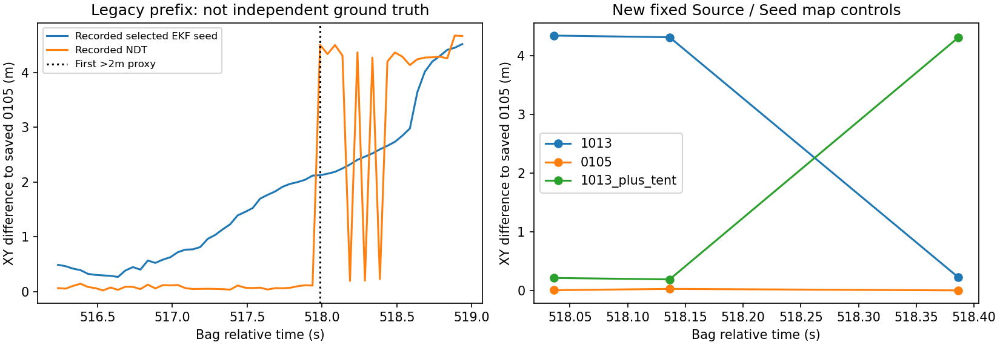

# loop44+1013：两个不同经过与真实错峰

## 时间/身份纠正

CONFIRMED：bag recorder与旧profiling零点相差120.986348916s。旧395–397s对应bag515.986–517.986s，**不是713s**。区域描述保留“回pit附近困难弯”，不命名T8。

| 合同 | 私有账本ID | bag相对(s) | 旧相对(s) |
|---|---|---:|---:|
| 旧首次多米错峰 | FIRST_SWITCH | 517.986342260 | 396.999993344 |
| 用户713.036342900 | REQUEST_713_A | 713.036342900 | 592.049993984 |
| 用户713.236339060 | REQUEST_713_B | 713.236339060 | 592.249990144 |
| 已找到的最后capture | LAST_CAPTURE | **713.936356724** | 592.950007808 |

用户714.936356724s没有exact capture，不能擅自将713.936当成它。原始post-preprocess Source、Target、Seed独立SHA和header已保存；尚不能逐一证明它们对应哪一组三个原始LiDAR消息ID，标UNKNOWN，不伪造。

1013全图复用旧manifest SHA `5d165afc16f22aaad785711a37575673b09587f1d934edb5cb6dc85b2f52de8f`，不重哈希约1.93GB地图。0105身份及局部captured targets分开保存。源点在base、seed/final为captured PCD-map<-base；仅复用坐标，不重新做杆臂或TF。0105/1013对照均采用历史已冻结同坐标局部target，未覆盖原地图。

## 旧因果前缀：先有高残差/拒绝风险，随后seed偏移与错峰

保存的实际1013 profiling与选用EKF seed对照0105稳定NDT工程轨迹：

| 旧t(s) | bag约(s) | seed XY差(m) | 原NDT XY差(m) | cov[0]/PCL-like f |
|---|---:|---:|---:|---:|
|395.750042|516.736391|.446|.084|12.786|
|396.000050|516.986399|.626|.111|27.133|
|396.500040|517.486389|1.454|.069|23.983|
|396.950001|517.936350|2.117|.109|20.868|
|396.999993|517.986342|2.124|4.506|10.232|
|397.150000|518.136349|2.249|4.309|7.718|
|397.400009|518.386358|2.598|.225|6.868|
|397.750012|518.736361|4.201|4.279|1.141|

CONFIRMED：大偏移前存在“正确附近但高fitness”的候选，seed先逐渐远离；第一次已记录>2m分支在517.986s，且converged、matcher measurement_valid=1。这里的>2m只是离线标记，不是新门控。match validity不是EKF接受，更不是最终提交。

历史生产callback cov>8拒绝日志与profiling一致：旧395.700040～397.100001连续29帧、约1.449961s，seed横向又漂约.96m。不能称纯预测漂移：五步队列旧观测与其他源可能仍在更新。早期三次类似通过也有更长拒绝（2.10/1.95/1.85s）而未错峰，说明仅拒绝时长不充分。旧395.35窗口111帧，1013有31高cov、37错峰代理，最大差4.676787m；0105无高cov/错峰代理、最大.033461m。它们是**旧生产因果闭环**，不是本轮新15D结果。

HYPOTHESIS（强证据）：地图缺失抬高残差→正确观测被callback拒绝→seed偏移使错误盆地可达→错误候选残差反而下降、进入更强信任区→反馈持续。SOURCE/SEED的地图因果已由冻结对照隔离；每帧最终Kalman信息量、撤销与原生P缺记录，反馈全过程不能声称已完整观测。低fitness正确性判据在此已被反例否定。

## 本轮35次CUDA：当前配置与历史配置严格分开

配置固定C1 matcher身份：DIRECT7/GLL3/q50/resolution1.5/step.2/max35/transε.01/relε.001，保留Native、PCL Fitness ON；不采用P4 OFF作为默认新条件。Target已捕获局部地图，不新增crop。18个713经过原始输入、8个真正首次切换前后输入、3帧×3地图=9控制，总35。没有Seed搜索。

旧CPU/历史GPU各参数/q/二进制不全，不能把新结果称逐位历史复现。32例存在旧final，平移差最小.000000183m、最大.008069m；3个plus-tent缓存无对应原名final文件，旧final parity不可评。实测差异保留，未以容差包装为同优化条件。

| 旧t(s)，同Source/Seed | 当前1013 XY差(m) | 当前0105 XY差(m) | 当前1013+tent XY差(m) |
|---|---:|---:|---:|
|397.049992|4.337820|.006505|.2146|
|397.150000|4.3096|.0284|.1905|
|397.400009|.2252|.0030|**4.3058**|

这里差值相对保存0105工程轨迹，不是独立真值。最后一行是重要失败：加结构不保证从任意已偏seed恢复，不能只报告前两行收益。旧首次396.999993 CPU同帧结果4.503192/.038422/.236634来自原始报告及表格，未把它们误放到713s。

当前1013原始首次切换输入8例全收敛，最大4.506331m；错误例C4_22局部尺度化信息投影特征值全正（约1112/2368/101486），低弱方向信息是风险线索而非正确性证书。713组18例11收敛、7MAX_ITERATIONS，最大与配对0105差.826768m，支持比例.395–.839；**本组未复现4–5m分支**。它不否定另一经过的真实故障。

## 尚未执行的15D E2

没有在这些header的合法15D prior/P、历史输入与已接纳观测检查点。旧生产EKF seed不能冒充15D状态。C1的共同初始化来自0105录制定位合同；仅少量局部target同坐标不能自动认证新1013全图起点、原点/参考点与长时runner完整合同。本轮没有建立并运行新的130～724s全图基线，也没有冷启动代替它。

因此：15D对同一错峰的真实P/K、接受/拒绝后的预测安全性、反馈正循环与实际恢复均UNKNOWN。E2保留为未执行项，而非宣称“当前保护成功”；不因为已有用户许可就跳过前置合同。若后续进行一次长基线，需先冻结上述地图初始化合同、历史配置/当前配置分组及有界资源清单，不能无记录地恢复全部点云。

## 地图控制点集核验

三组局部1013/plus-tent文件分别94971/99592、92887/97508、84199/88820点；逐点XYZ集合比较，原1013缺失点均为0，增加的唯一点均为4621。这支持“只加保存结构”的受控变量，不只是不同目录名称。0105仍是独立地图对照，不冒称只多帐篷。结构点来自旧授权缓存，本轮未修改或写回地图。

原始header/消息身份的精确账本保留在授权磁盘完整报告；公开版仅给去标识ID与诊断相对时间。
