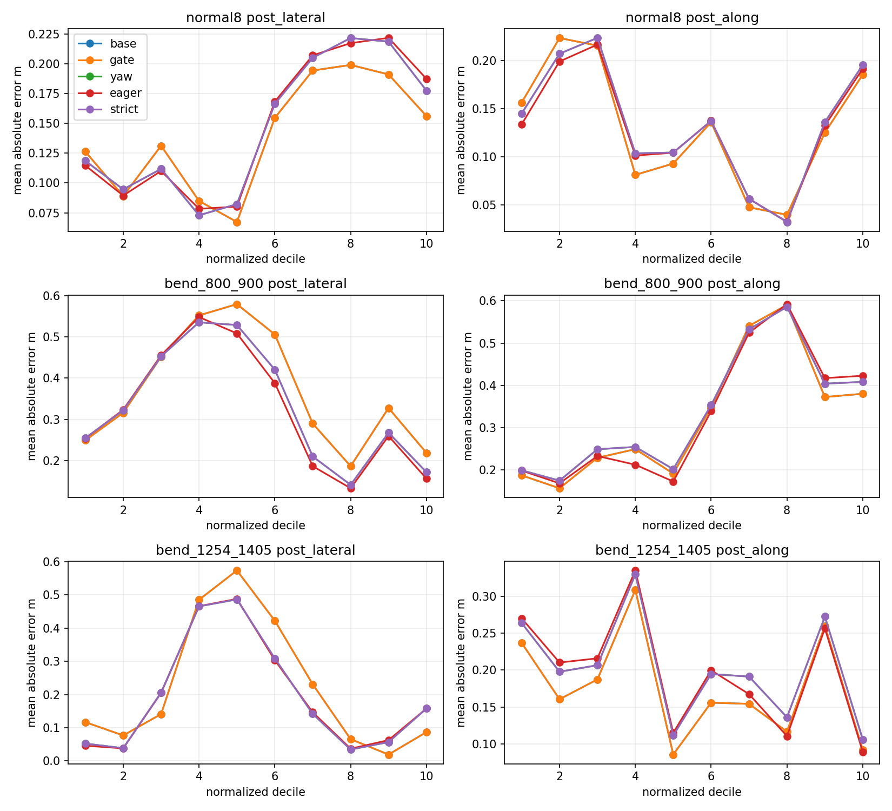
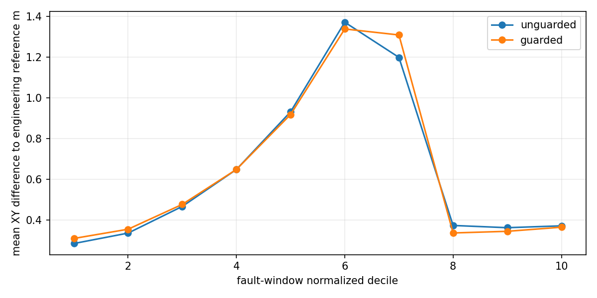

# Phase G2-E：GICP 观测健康与航向反馈

基于 `16fbf7a` 的生产 `lidar_ndt::GicpRegistration`、15D ESKF、G2-V C 互斥 Wheel/Kistler vx 与真实 vy。主机 CUDA Deskew 和 GICP 在 loop44 连续三圈运行 4134 帧。所有新策略均由 `--g2e-*` 显式启用；生产仓库、GICP、状态维数、IMU/速度 Q/R 和默认 LiDAR 位置方差 0.25 m²、姿态方差 (1°)² 未改。评价使用原 Phase AW 物理转换生成的 75 ms GNSS 工程参考，原始有效 3635 帧；历史 CSV 已不在本机，因此没有重建 historical-valid mask。此参考不是独立绝对真值。

## 源码审查与机制

本机原生产 `ekf_converter` 在 Bosch IMU 新鲜度 50 ms 内取其角速度，否则回退 VectorNav；低速有效 Wheel vx、高速滤波 Kistler vx，状态异常时提高速度协方差。姿态输入依配置选择 NDT/GNSS/VectorNav 等，GNSS 固定状态、位置不确定度和 yaw 来源分别处理。原生产 `ekf_localizer` 是 `x,y,yaw,yaw_bias,vx,wz` 的 6D 平面滤波器，位姿只更新 x/y/yaw，速度只更新 vx/wz；它以测量延迟选择增广历史状态，使用 Mahalanobis 门控及 pose smoothing。生产 Deskew 的 AHRS/Kistler 运动模型不等于这个 6D EKF。当前研究 15D 以 Bosch IMU 积分 p/v/R/bg/ba、Kistler vx/vy 修正速度，GICP 在观测 Header 用完整 x/y/z/SO(3) 更新，Joseph 协方差和历史重传播保留。

[Autoware EKF 文档](https://autowarefoundation.github.io/autoware_core/main/localization/autoware_ekf_localizer/)确认位姿/速度门控、平滑和延迟处理的工程先例。本机生产源对应 `ekf_converter/src/ekf_converter.cpp`、`ekf_localizer/src/ekf_module.cpp`；其 NDT fitness 协方差分档不能直接移植成 GICP 统计 R。[FAR-LIO 当前公开仓库](https://github.com/TUMFTM/FAR-LIO)只暴露 README，无法在本轮核对其具体健康状态机实现，因此不把本实验的 R 膨胀归称为 FAR-LIO 原算法。传感器状态变化时调整观测可信度这一思路另可在 [TUM 的公开 3D 状态估计源码](https://github.com/TUMFTM/3DVehicleDynamicsStateEstimation)核对；本轮只实现了单因素、显式研究开关。

新增 `PoseHealth` 在先验检查点计算 6D 残差：平移在 map 系，姿态为 `Log(R_priorᵀ R_GICP)`；`S=HPHᵀ+R`，主门控为 6 自由度 NIS > 22.458（χ² 99.9%），3D 平移/旋转边际 NIS 及其 16.266 门限仅记录诊断，避免重复判决。另设平移 5 m、旋转 5° 的异常物理边界；先要求 GICP 收敛且候选有效。无可靠观测时 IMU/Kistler 预测持续，状态记录 TRACKING、DEGRADED、LOST、RECOVERING。失效≥0.5 s 后首个恢复观测 R×4、后两次 R×2，再回基线；正常单帧匹配失败不触发 R 膨胀。没有用低 NIS 证明匹配正确。

## 连续三圈闭环 A/B

| 策略 | 接纳/4134 | 全圈横向/纵向/XY RMSE m | 入弯横向/纵向/XY m | 正常段8横向 P95 m | p99 帧耗时 ms |
|---|---:|---:|---:|---:|---:|
| 原 C 基线 | 3996 | .215/.325/.390 | .278/.335/.435 | .266 | 60.95 |
| 仅 6D 门控 | 3996 | .215/.325/.390 | .278/.335/.435 | .266 | 61.16 |
| 仅 yaw 方差×0.5 | 3971 | .204/.327/.386 | .251/.331/.416 | .284 | 61.90 |
| 门控+yaw+单帧触发 R（失败对照） | 3976 | .206/.330/.389 | .253/.337/.421 | .290 | 61.49 |
| 门控+yaw+≥0.5 s 才恢复 R | 3971 | .204/.327/.386 | .251/.331/.416 | .284 | 61.33 |

门控基线的 3996 个可用匹配均通过，NIS6 中位/P95/P99/最大为 1.490/4.115/6.365/10.435；138 个匹配未收敛或无效。最大接纳间隔 0.201 s，故严格恢复方案在自然三圈中没有 R 膨胀，也没有正常精度收益。用工程参考识别的 74 个原始匹配横向差 >0.5 m 的有效样本中，65 个 NIS6 <5；这只是参考相对差，不能称为 74 个真实错误匹配，但说明 NIS 无法代替外部质量证据。

基线 800–899 帧的 Seed/原始 GICP/后验横向 RMSE 为 .407/.339/.396 m；1254–1405 为 .313/.170/.297 m。原始匹配往往比后验更接近参考，局部偏移含有低增益反馈保留。基线 yaw 创新/后验修正的绝对中位为 .237°/.0103°，P95 为 1.118°/.0530°；在 800–899 分别为 .537°/.0297°，1254–1405 为 .455°/.0191°。yaw 方差减半后后验 yaw 修正全圈中位/P95 升为 .0122°/.0652°，局部横向改善：800–899 横向 .396→.362 m、1254–1405 .297→.258 m；但相应纵向 .375→.383、.251→.268 m。正常段8第1/2/3圈横向 P95 从 .246/.282/.189 变成 .267/.306/.153 m；出弯 XY .311→.316 m。航向反馈是局部因素，不能解释全部偏移，也不能按总体 XY 小幅下降直接提升权重。

失败的单帧触发 R 方案在正常三圈把 149 帧设为 R×4、271 帧为 R×2，削弱了正常 LiDAR 反馈，纵向/XY 比 yaw 单因素变差。限定连续失效≥0.5 s 后，4134 帧的 R 全为×1，结果与 yaw 单因素相同；保留这一**触发条件**供丢失恢复，不保留无条件单帧膨胀。全圈 p99 仍约 61 ms，超过 50 ms。

恢复工作环境后的第一次门控回放误用了只含第一圈的 7535 条光学速度事件，至第 2978 帧因连续匹配失败触发 2 s 停机；继续运行的诊断也只接纳 2877/4134。核对 G2-L 的光学文件 SHA 后，使用多圈绑定重提取 20865 条事件，得到与 G2-L 完全相同的输入 SHA，重新执行上表全部实验。因此这次输入覆盖失败只作为复现故障记录，不用于评价门控效果。



## 受控异常与观测丢失

在相同 900 帧前缀、frame 800 注入单帧 +3 m x/+4° yaw，frame 820–864 强制 45 帧匹配失效。两组均显式允许超过原 2 s 停机条件继续预测。无门控 EKF 接纳注入帧（NIS≈55.29）；门控拒绝。两组在第 865 帧重新接纳，最大接纳间隔 2.300 s，没有锁死。门控组先进入 LOST，恢复观测依次 R×4、×2、×2，然后回基线；其恢复后 35 帧工程参考 XY RMSE 为 **0.501 m**，无门控为 **0.438 m**。门控组当帧 XY .268 m、无门控 .254 m；拒绝这一次人为错误没有带来参考精度收益，只验证了异常拒绝与连续性。若不显式允许继续预测，原回放驱动会在 2 s 停机，这是故障测试设置而非生产行为。



## 决策

- **研究 GO：** 保留 opt-in 6D NIS/物理边界诊断、原始匹配有效性判断、失效状态记录和≥0.5 s 后有限恢复 R。受控测试验证拒绝突发错误和恢复接纳；正常三圈没有误拒。
- **精度改进 NO-GO：** yaw 方差减半虽降低局部横向与全圈 XY，却恶化正常段8前两圈、局部纵向和出弯；单帧触发 R 更差。不得提升为生产或研究默认配置。
- **生产 NO-GO：** R 未统计校准、工程参考非独立真值、严格 50 ms p99 未达成、在线 ROS 时序/其他圈与地图未验证。下一步优先取得独立姿态/位置参考和 GICP 质量特征，针对 1254–1405 的“匹配优于后验”设计可验证的反馈权重，不按参考路段手工调 R。

## 复现

需授权的私有 loop44/map/TF、完整多圈 Kistler 历史、主机 CUDA 和生产 GICP 头文件。先按 [G2-V 说明](../g2_velocity/RESULTS.md)以**多圈绑定**提取/滤波光学速度，并按 [生产桥说明](../g2_production_bridge/RESULTS.md)编译 `gicp15d_production_service`。从私有数据根目录运行；`RESEARCH_ROOT` 为本独立研究仓库，`PRIVATE_ROOT` 为未跟踪实验目录：

```bash
export PYTHONPATH="$RESEARCH_ROOT/src:$RESEARCH_ROOT/experiments/phase_gicp15d_pipeline/g2_deterministic:$RESEARCH_ROOT/experiments/phase_gicp15d_pipeline/g2_velocity"
export OPENBLAS_NUM_THREADS=1
export G2_PRODUCTION_MATCHER="$G2_BUILD/gicp15d_production_service"
for variant in base gate yaw strict; do
  case "$variant" in
    base) flags=() ;;
    gate) flags=(--g2e-gate) ;;
    yaw) flags=(--g2e-yaw-variance-scale 0.5) ;;
    strict) flags=(--g2e-gate --g2e-yaw-variance-scale 0.5 --g2e-recovery --g2e-continue-loss) ;;
  esac
  python3 "$RESEARCH_ROOT/experiments/phase_gicp15d_pipeline/g2_velocity/run_g2v.py" \
    --input data/phase_ao_ap_validation/loop44.json \
    --bindings data/phase_as_accuracy_quality/bindings_multilap.json \
    --target data/inputs/map_target.bin \
    --deskew data/phase_ar_loop44_map0105/runtime/deskew_service \
    --deskew-service data/phase_ar_loop44_map0105/runtime/deskew_service \
    --matcher "$RESEARCH_ROOT/experiments/phase_gicp15d_pipeline/g2_deterministic/matcher_production_roi10.sh" \
    --optical "$FILTERED_OPTICAL_FULL" --private "$PRIVATE_ROOT/$variant" \
    --output "$PRIVATE_ROOT/$variant-summary.json" --policy C --window multilap \
    --prune-geometry "${flags[@]}"
done
```

临时参考可用 Phase AW `evaluate.py` 的 `reference()`，使用原 Phase AT 绑定、4134 个原生 Header；若历史 GNSS CSV 缺失，只评价 `raw_valid_0.075`，不得伪造 historical-valid 结论。`analyze_g2v.py --valid-key raw_valid_0.075` 生成私有逐帧诊断；`analyze_g2e.py` 生成已去标识的汇总曲线。受控测试对 `run_g2v.py` 加 `--limit 900 --g2e-inject-frame 800 --g2e-drop-start 820 --g2e-drop-count 45 --g2e-continue-loss`，门控组再加 `--g2e-gate --g2e-recovery`。逐帧事务、传感器事件、轨迹、完整参考均留在私有目录，未提交。

```bash
python3 "$RESEARCH_ROOT/experiments/phase_gicp15d_pipeline/g2_velocity/analyze_g2v.py" \
  --input data/phase_ao_ap_validation/loop44.json --reference "$PRIVATE_REFERENCE" \
  --valid-key raw_valid_0.075 \
  --run base "$PRIVATE_ROOT/base" --run gate "$PRIVATE_ROOT/gate" \
  --run yaw "$PRIVATE_ROOT/yaw" --run strict "$PRIVATE_ROOT/strict" \
  --output "$PRIVATE_ROOT/analysis"
python3 "$RESEARCH_ROOT/experiments/phase_gicp15d_pipeline/g2_velocity/analyze_g2e.py" \
  --analysis "$PRIVATE_ROOT/analysis" --reference "$PRIVATE_REFERENCE" \
  --run base "$PRIVATE_ROOT/base" --run gate "$PRIVATE_ROOT/gate" \
  --run yaw "$PRIVATE_ROOT/yaw" --run strict "$PRIVATE_ROOT/strict" \
  --output "$PRIVATE_ROOT/public_aggregate"
```

验证：21 个 Python 单元测试通过；生产 GICP 桥编译及 CTest 通过；五个 4134 帧闭环、900 帧受控故障双组完成。完整研究代码和配置哈希见 manifest。
