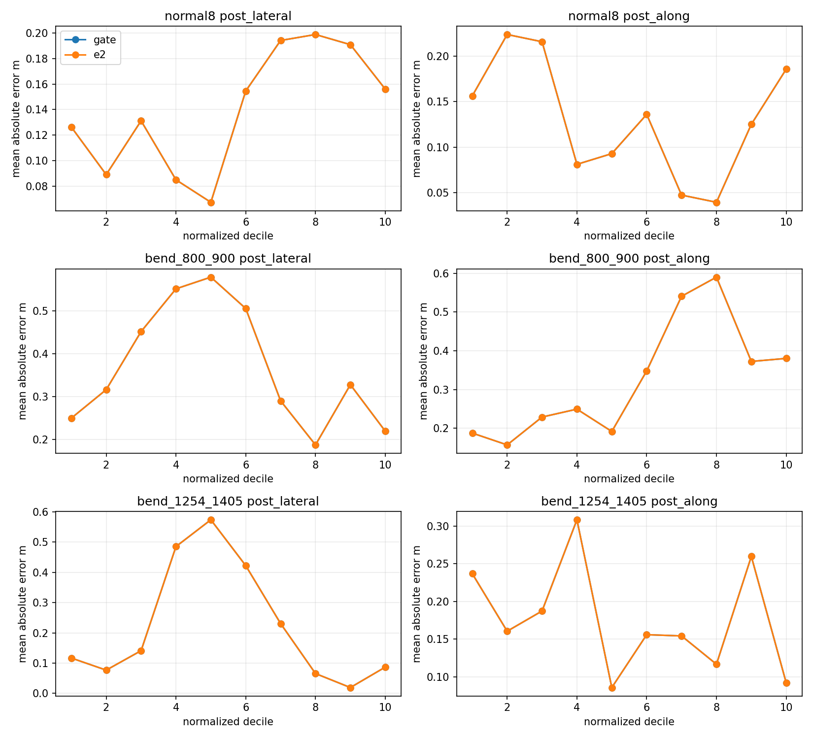
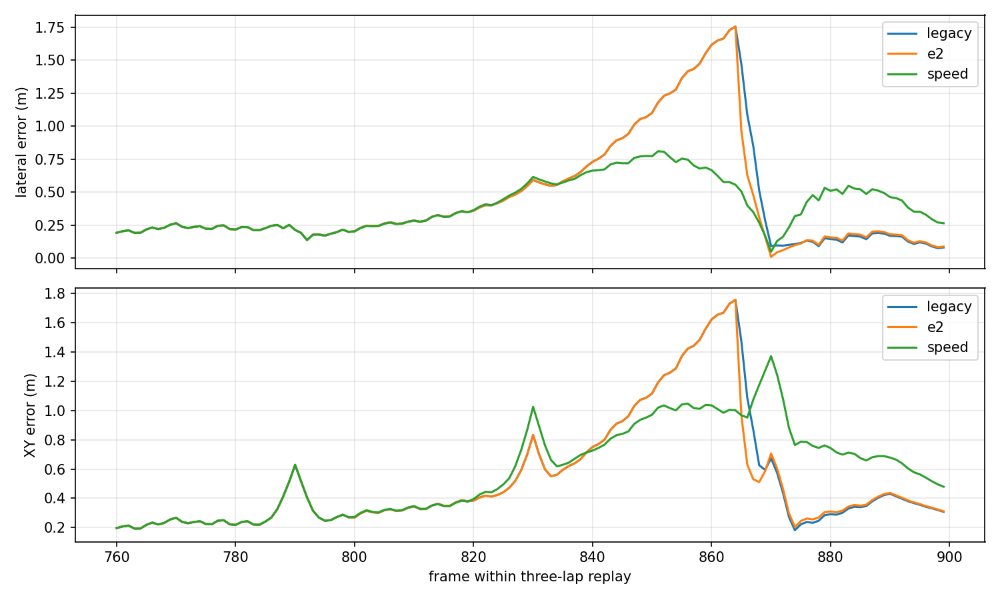
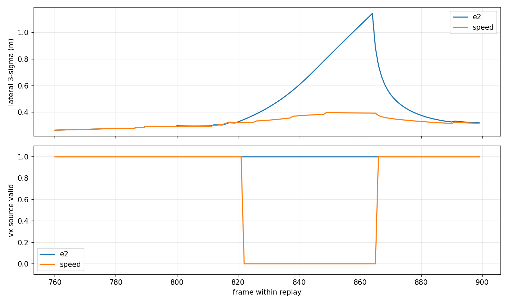

# Phase G2-E2：观测健康、恢复强度与三圈闭环

基于 `397b052`，保留生产 `lidar_ndt::GicpRegistration`、15D ESKF、Kistler C 互斥 vx+真实 vy、完整 6D LiDAR 观测和原 Q/R。使用主机 CUDA Deskew 完成 loop44 连续三圈 4134 帧，以及各 900 帧的错误匹配/位姿中断和速度中断回放。新功能仅以 `--g2e2-*` 启用，生产源码与默认配置未修改。评价为 Phase AW 75 ms GNSS 工程参考的相对误差，3635 帧 raw-valid；它不是独立绝对真值。

## 源码判断与实现

[逐项源码核对](SOURCE_AUDIT.md)直接依据 FAR-LIO 的 `base.hpp`、`ekf.hpp`、`state_machine.hpp` 和 Autoware Core 的 `ekf_localizer.cpp`。更正 G2-E 的公开源码可见性错误：FAR-LIO 指定文件可读取。FAR-LIO 在位置/姿态有效位变化后分别将 R 置上限并渐退，速度也有独立有效位；Autoware 分开记录 pose/twist 缺测、门控与延迟，并输出 XY/横向误差椭圆。其安全停机状态锁存依赖上层车辆控制接口，本离线回放不照搬。

G2-E 已有收敛/候选校验、6D SO(3) 残差、`S=HPHᵀ+R` NIS 门控（χ² 六自由度 99.9% 为 22.458）、5 m/5° 物理边界、历史回滚和 Joseph 更新。Autoware 当前源码的 pose/twist Mahalanobis 门控使用状态 `P_y`，再以测量 R 更新；本研究保留现有 `S` 语义及门限，不套用 Autoware 默认值。先前 G2-E 的单帧 R 膨胀损伤正常精度，长失效后 R×4/×2/×2 也增加受控恢复误差，因此没有把 FAR-LIO 的数值上限照搬到未校准的 GICP R。

新增研究开关分别记录 IMU、Wheel vx、Kistler vx/vy 的**已融合更新**及年龄、缺测帧数和综合状态。IMU 新鲜度用现有 15D 传播器的 25 ms 上限，速度源沿用 100 ms 互斥策略；GICP 位姿用已有 TRACKING/DEGRADED/LOST/RECOVERING。3σ 主轴、车辆纵向和横向半径从**观测 Header 时刻后验 P**计算。恢复单因素 `--g2e2-recovery-baseline` 保持位置 0.25 m²、姿态 (1°)² 基线 R，让失效期间传播所得 P 进入 NIS 和 Kalman Gain，而不盲目削弱第一笔有效回归观测。光学速度仍使用自身输入方差，Wheel 使用其现有方差；没有从 GNSS 路段或匹配 Hessian 反推 R。

生产 `ekf_converter` 在 Bosch 角速度超过 50 ms 未更新时回退 VectorNav；速度按低速 Wheel/高速 Kistler 选择，异常时提高速度协方差，姿态可由 NDT/GNSS 等输入。研究闭环只使用当前数据中的 Bosch IMU、Kistler/Wheel 和 GICP 姿态，**没有实现未经验证的 VectorNav 切换**；它不会把生产 Deskew 的 AHRS 模型误认成 EKF。G2-E 的 yaw 方差减半已使正常段 8 和局部纵向退化，本轮未重试或提升姿态权重。
G2-E 已测得 800–899/1254–1405 的 yaw 创新绝对中位约 0.537°/0.455°，而后验修正仅 0.0297°/0.0191°；这一低增益现象在 E2 的自然三圈中未改变。因此本轮只在长期失效且 P 增长的受控情形验证姿态反馈强度，不用工程参考反推新的姿态 R。

## 三圈单因素 A/B

| 方案 | 接纳/4134 | XY/横向/纵向 RMSE m | 正常段8横向 P95 m | 800–899 横向 RMSE m | 1254–1405 横向 RMSE m | 帧 p99 ms |
|---|---:|---:|---:|---:|---:|---:|
| G2-E 6D gate + 长失效 R×4/×2/×2 | 3996 | .390/.215/.325 | .266 | .396 | .297 | 64.54 |
| E2 分源健康诊断 + 恢复基线 R | 3996 | .390/.215/.325 | .266 | .396 | .297 | 61.15 |

两组自然三圈没有 ≥0.5 s 位姿失效，最长接纳间隔 0.201 s；GICP 有效的 3996 帧均通过 NIS 门控，其余 138 帧匹配未收敛或候选无效。E2 正常运行记录 3996 帧 TRACKING、138 帧 DEGRADED，4134 帧 vx 均来自 Kistler；Bosch IMU 在观测 Header 的最大年龄 5.96 ms。横向/纵向 3σ 半径的 P95 为 0.384/0.253 m。按临时参考，3635 个有效帧中 378 帧横向差超过滤波器 3σ，提示不能把该椭圆直接当成已校准的安全边界。p99 两次运行的差异含主机调度波动，不构成性能改善证据；仍超过 50 ms。



## 受控失效：可信度与恢复强度

在 frame 800 对单次匹配注入 +3 m map x/+4° yaw，在 820–864 强制 45 帧位姿缺失；保留 IMU/Kistler 预测并允许超过回放驱动原 2 s 停机测试阈值。旧/E2 门控均以 NIS6 55.29 拒绝注入帧；均在 frame 865、距前次接纳约 2.30 s 时重新接纳，未锁死。恢复匹配的旧 R×4 NIS6 为 4.58，E2 基线 R 的 NIS6 为 13.50，仍低于 22.46；第一笔恢复的横向 Kalman Gain 0.133→0.364，横向位置修正 −0.302→−0.819 m，Yaw 修正 −0.272°→−0.743°。这是有状态不确定度支持的更强反馈，而非新的 Q/R 调参。

| 900 帧故障方案 | 接纳 | 865–899 横向/纵向/XY RMSE m | 800–899 XY RMSE m | 结论 |
|---|---:|---:|---:|---|
| 旧恢复 R×4/×2/×2 | 825 | .377/.330/.501 | .765 | 拒错且恢复，但第一笔反馈被削弱 |
| E2 恢复基线 R | 825 | .256/.345/.430 | .750 | 横向与 XY 改善，纵向小幅恶化 |

E2 位姿中断时横向 3σ 半径从 frame 819 的 0.320 m 增至 864 的 1.142 m，frame 899 回落到 0.321 m；LOST 记录 5 帧。NIS 门控无法证明通过的匹配正确，且该故障是人工单次大偏移；它只验证明显异常拒绝、失效后重新接纳及恢复强度。

另在 820–864 同时删除 Wheel/Kistler 速度事件，GICP 继续工作。前 900 帧 GICP 接纳仍为 867，与无故障前缀相同；健康状态有 44 帧无有效 vx、44 帧 LOST，IMU 未中断，速度在 frame 866 重获 Kistler。与无故障前缀相比，865–899 横向/纵向/XY RMSE 从 .254/.514/.573 变为 .408/.703/.813 m；800–899 XY 从 .546 到 .752 m。速度源失效会造成预测与后验连续偏移，匹配接纳率没有发现它；当前机制能如实标识但尚未消除该误差。其横向 3σ 在中断尾部约 0.394 m，明显低于同长度 LiDAR 缺失的 1.142 m；这不能被解释为速度失效下的已校准覆盖率。





## 决策

- **研究防护 GO：** 保留 opt-in 分源有效性/超时/缺测诊断、Header 后验协方差椭圆、已有 6D NIS/物理门控和长失效恢复时的基线 R。它们没有误拒自然三圈观测，在受控异常后不中断并使位姿恢复横向/XY 优于旧 R 膨胀。
- **自然精度改进 NO-GO：** 三圈全圈与困难弯道误差完全未变；恢复 A/B 的纵向略差。不能把受控故障收益写成正常路段精度提升。
- **生产 NO-GO：** 速度中断虽被识别但后续 35 帧 XY 恶化，临时参考非独立真值，椭圆/R 未校准，VectorNav 回退和 ROS 在线时序未验，p99 仍约 61 ms。下一步优先验证速度失效下的预测可信度与安全降级，再取得独立姿态/位置参考核查正常过弯低增益反馈；不继续按路段试 R 倍率。

## 复现

要求授权的 loop44/map/TF、完整多圈 Kistler 事件、主机 CUDA 与生产 GICP 头文件。以 [G2-V 提取流程](../g2_velocity/RESULTS.md)生成 20865 条过滤光学事件，SHA256 为 `a8ae6025abd3be15f9a9daf97b0749b735df2f4e30486f9761a2a9fab5ee91f2`；使用 [G2 桥编译流程](../g2_production_bridge/RESULTS.md)构建 `gicp15d_production_service`。在私有数据根目录运行，下列变量指向本地授权资源，所有逐帧轨迹/日志仅留在私有输出目录：

```bash
export PYTHONPATH="$RESEARCH_ROOT/src:$RESEARCH_ROOT/experiments/phase_gicp15d_pipeline/g2_deterministic:$RESEARCH_ROOT/experiments/phase_gicp15d_pipeline/g2_velocity"
export OPENBLAS_NUM_THREADS=1 G2_PRODUCTION_MATCHER="$BUILD_DIR/gicp15d_production_service"
runner="$RESEARCH_ROOT/experiments/phase_gicp15d_pipeline/g2_velocity/run_g2v.py"
common=(--input data/phase_ao_ap_validation/loop44.json \
  --bindings data/phase_as_accuracy_quality/bindings_multilap.json \
  --target data/inputs/map_target.bin \
  --deskew data/phase_ar_loop44_map0105/runtime/deskew_service \
  --deskew-service data/phase_ar_loop44_map0105/runtime/deskew_service \
  --matcher "$RESEARCH_ROOT/experiments/phase_gicp15d_pipeline/g2_deterministic/matcher_production_roi10.sh" \
  --optical "$FILTERED_OPTICAL_FULL" --policy C --window multilap --prune-geometry)
python3 "$runner" "${common[@]}" --private "$PRIVATE_ROOT/gate" --output "$PRIVATE_ROOT/gate-summary.json" --g2e-gate --g2e-recovery
python3 "$runner" "${common[@]}" --private "$PRIVATE_ROOT/e2" --output "$PRIVATE_ROOT/e2-summary.json" --g2e-gate --g2e2-health --g2e2-recovery-baseline
python3 "$runner" "${common[@]}" --limit 900 --private "$PRIVATE_ROOT/fault-legacy" --output "$PRIVATE_ROOT/fault-legacy-summary.json" --g2e-gate --g2e-recovery --g2e-continue-loss --g2e-inject-frame 800 --g2e-drop-start 820 --g2e-drop-count 45
python3 "$runner" "${common[@]}" --limit 900 --private "$PRIVATE_ROOT/fault-e2" --output "$PRIVATE_ROOT/fault-e2-summary.json" --g2e-gate --g2e2-health --g2e2-recovery-baseline --g2e-continue-loss --g2e-inject-frame 800 --g2e-drop-start 820 --g2e-drop-count 45
python3 "$runner" "${common[@]}" --limit 900 --private "$PRIVATE_ROOT/fault-speed" --output "$PRIVATE_ROOT/fault-speed-summary.json" --g2e-gate --g2e2-health --g2e2-recovery-baseline --g2e-continue-loss --g2e2-speed-drop-start 820 --g2e2-speed-drop-count 45
```

临时参考按 [G2-E 参考说明](../g2_health/RESULTS.md)从 Phase AW 原 `evaluate.py::reference()` 生成，只采用 `raw_valid_0.075`，不可伪造 historical-valid。对比分析：

```bash
python3 "$RESEARCH_ROOT/experiments/phase_gicp15d_pipeline/g2_velocity/analyze_g2v.py" \
  --input data/phase_ao_ap_validation/loop44.json --reference "$PRIVATE_REFERENCE" \
  --valid-key raw_valid_0.075 --run gate "$PRIVATE_ROOT/gate" --run e2 "$PRIVATE_ROOT/e2" \
  --output "$PRIVATE_ROOT/full-analysis"
python3 "$RESEARCH_ROOT/experiments/phase_gicp15d_pipeline/g2_velocity/analyze_g2e.py" \
  --analysis "$PRIVATE_ROOT/full-analysis" --reference "$PRIVATE_REFERENCE" \
  --run gate "$PRIVATE_ROOT/gate" --run e2 "$PRIVATE_ROOT/e2" --output "$PRIVATE_ROOT/full-aggregate"
python3 "$RESEARCH_ROOT/experiments/phase_gicp15d_pipeline/g2_velocity/analyze_g2e2.py" \
  --input data/phase_ao_ap_validation/loop44.json --reference "$PRIVATE_REFERENCE" \
  --run legacy "$PRIVATE_ROOT/fault-legacy" --run e2 "$PRIVATE_ROOT/fault-e2" \
  --run speed "$PRIVATE_ROOT/fault-speed" --output "$PRIVATE_ROOT/fault-aggregate"
```

验证：24 个相关 Python 单元测试、生产 GICP 桥 CTest 通过；2×4134 帧与 3×900 帧自反馈回放完整。具体代码/配置/输入身份见 [manifest](manifest.json)。
