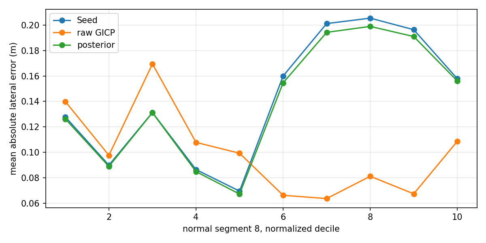
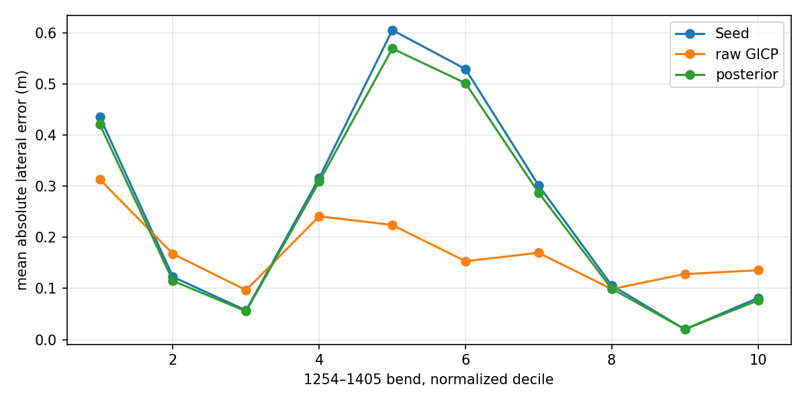

# Phase G2-L：横向反馈与连续三圈验证

基于 `16d0446`，保持生产 `lidar_ndt::GicpRegistration`、15D 状态、G0 LiDAR Q/R、G2-V C 互斥速度源和完整 6D 位姿观测。主机 CUDA Deskew + GICP 真实自反馈连续执行 4134 帧，未逐圈重置。参考是原有 75 ms 假设的 GNSS **工程参考**，只用于相对比较；未经独立时间、杆臂、安装与协方差标定，数值不是认证绝对精度。

## 生产 6D 与研究 15D 的实际代码差异

| 环节 | 生产 `ekf_localizer` + `ekf_converter` | G2 15D ESKF |
|---|---|---|
| 状态 | 平面 `x,y,yaw,yaw_bias,vx,wz`；另用 1D 滤波处理 z/roll/pitch | `p(3),v(3),R(SO3),bg(3),ba(3)`；完整交叉协方差 |
| 预测 | `vx cos(yaw+yaw_bias), vx sin(yaw+yaw_bias), wz` 的定速平面运动学；F 对 yaw/yaw_bias/vx/wz 显式线性化 | IMU 角速度与比力积分位置、速度、姿态；F 耦合姿态、速度及两类 bias；`P=FPFᵀ+GQGᵀ` |
| 速度 | converter 按低速 Wheel、高速滤波 Kistler vx 选择，twist 用 `vx,wz`；发布虽含 vy，但 6D twist 观测矩阵只读 `vx,wz` | Wheel vx 或 Kistler vx 互斥，Kistler vy 为真实侧滑观测；角速度用于传播并估计 `bg` |
| 位姿观测 | `x,y,yaw`；R 随 smoothing steps 放大，增广历史状态做延迟近似更新 | GICP 完整 `x,y,z,rx,ry,rz`，在传感器 Header 精确检查点更新并重传播；Joseph 形式与 SO3 chart reset |
| 时序 | ROS timer 实测周期预测；pose/twist stamp 加配置 delay 后选最近历史索引；converter 按 IMU stamp 发布经 Kistler 滤波外推的速度 | 离线传感器 Header 排序，500 ms 有界历史重播；GICP 到达后在观测 Header 更新，匹配墙钟时间不推进逻辑时钟 |

生产 Deskew 的 AHRS+Kistler 预积分是另一模块，不能当作生产 6D EKF 的运动方程。6D 在高速弯道忽略真实 vy，转弯和侧滑时平面位移可能偏；其优势是速度直接驱动位置、少受加速度 bias 积分误差影响。15D 能保留侧滑和三维惯性/Bias 耦合，但持续依赖 IMU 偏置、速度观测与 LiDAR 反馈。这里没有将两个实现放在相同 GICP 输入下做受控 6D/15D 闭环，模型优劣是源码推论，不是实测优胜声明。

## 连续三圈与正常段 8

| 指标 | GICP+15D+C |
|---|---:|
| 执行 / 6D GICP 接纳 | 4134 / 3996，96.66% |
| 全三圈工程参考有效 / XY RMSE | 3635 / 0.390 m |
| 第 1 / 2 / 3 圈 XY RMSE | 0.374 / 0.401 / 0.394 m |
| 第 1 / 2 / 3 圈横向 RMSE | 0.213 / 0.238 / 0.192 m |
| 最长接纳间隔 | 0.201 s |
| 帧耗时 p50 / p95 / p99 / max | 20.32 / 57.95 / 94.38 / 460.73 ms |

速度源日志记录 20671 次有效 Kistler vx+vy 更新、23 次有效 Wheel vx 兜底、15 次 Kistler 状态拒绝；20662 次 Wheel 事件因新鲜 Kistler vx 已融合而跳过，未重复计入纵向速度。该高速数据不能充分验证低速 Wheel 切换。

同一 AY 工程参考定义下，AY C 三圈 XY RMSE 为 0.519/0.568/0.452 m；这里的 GICP C 是不同匹配器与不同闭环轨迹，比较只说明该数据上的相对结果。单圈 G2-V C 的 0.372 m 使用 1197 个历史有效样本，三圈第 1 圈的 0.374 m 使用 1204 个扩展原始参考有效样本；不能把这 2 mm 当作算法变化。

正常段 8 的三圈横向 P95 为 **0.246/0.282/0.189 m**，第 1 圈 129 帧的 AY C 历史 P95 是 **0.424 m**。GICP C 没有延续 AY 的段 8 退化。三圈正常段 8 的原始 GICP 横向 RMSE 为 0.108/0.116/0.145 m，后验为 0.155/0.196/0.116 m：前两圈观测比后验更接近该参考，第 3 圈相反，不应把增大观测权重视为普适改进。



## 横向迟滞与运动预测

同一 Header 的单圈 800–900：Seed、原始 GICP、后验横向 RMSE 约 0.407/0.339/0.397 m；1254–1405 为约 0.313/0.170/0.297 m（后者三圈绑定的第 1 圈有效样本 139 帧）。后一区间原始匹配明显好于后验，且每帧后验纠正横向 RMSE 仅约 0.018 m，匹配对 Seed 的横向创新 RMSE 约 0.213 m；中位横向位置增益约 0.051。800–900 的对应创新/更新约 0.173/0.014 m，增益约 0.046。横向偏移有明显**低增益反馈保留**，并非 GICP 本身在该区间全部匹配错误。姿态与位置交叉项仍参与 K；800–900 平均 yaw 修正约 −0.027°/帧，1254–1405 约 −0.013°/帧，不能仅用平移标量增益解释全部运动。

在 C 中，1254–1405 的 Seed/后验 RMSE 差约 0.016 m；G2-V 已测的 1317–1405 平均新增预测横向误差从 Wheel 基线 0.0193 降到 C 0.0052 m/帧。高速预测仍有偏差，但 C 已大幅减轻。按三圈曲率阶段，入弯/弯心/出弯横向 RMSE 为 0.278/0.176/0.180 m，符号均值为 +0.054/−0.017/+0.061 m；**没有一致的“入弯滞后、出弯反向过冲”模式**。最坏入弯 P95 0.582 m，局部弯道仍需修复。参考时间比较用即时后验，已避开 G2-V 修复的约 54 ms 帧末错位。



速度滤波的既有单因素真实闭环 A/B（原始 Kistler C → 生产滤波 C）在相同 1468 帧上，全圈 XY 0.377→0.372 m、正常段 8 横向 P95 0.252→0.241 m，但 800–900 XY 0.529→0.546 m；滤波收益不普适。滤波 vy 与原始 vy 的相关峰在 0 个采样偏移（约 9–11 ms/采样），Kistler recorder−Header 中位 0.64 ms、P95 2.52 ms。离线滤波按原始 Kistler Header 计算，没有生产 10 ms ROS timer 的外推，因此不能排除现场定时细节；当前没有实测证据支持再平移观测时间戳。

## 结论与下一步

1. **滤波迟滞是局部主要贡献，具体在 GICP 位姿观测进入 15D EKF 的低增益反馈。** 运动预测也新增少量误差，但 C 已显著压低；匹配在 1254–1405 往往更接近工程参考。
2. **生产 6D 平面模型更直接、但不表达 vy；15D 惯性模型表达侧滑/Bias/三维运动，却依赖速度观测与稳定反馈。** 尚无同输入闭环模型 A/B 可以量化净优势。
3. **AY 正常段 8 退化在 GICP C 的三圈工程评价中消失。** 其他入弯误差与实时性问题仍在。
4. 下一步优先验证 **LiDAR 反馈的统计权重与观测质量**，需要独立位姿真值或校准的 GICP 残差协方差；已有 G2 直接转移 Legacy R 的 A/B 虽降低横向误差却恶化纵向/XY，故不改默认 Q/R。速度滤波和人为时间平移当前证据较弱。生产默认与 ROS 实时均 **NO-GO**；连续闭环研究验证 **GO**。

## 复现与保留

实际命令在独立研究仓库根目录，需已有授权的私有 map/bag/TF 绑定、ROS 消息安装和**主机 CUDA**。完整逐帧事务、状态、源选择、滤波与诊断图保留在私有实验输出，不提交公开仓库。`--prune-geometry` 只在每帧哈希和匹配结果记录后删除临时 Deskew 几何，避免三圈输出占满磁盘；不改变算法。

```bash
export PYTHONPATH="$RESEARCH_ROOT/src:$RESEARCH_ROOT/experiments/phase_gicp15d_pipeline/g2_deterministic"
export OPENBLAS_NUM_THREADS=1
export G2_PRODUCTION_MATCHER="$G2_BUILD/gicp15d_production_service"
cd "$PRIVATE_DATA_ROOT"
python3 "$RESEARCH_ROOT/experiments/phase_gicp15d_pipeline/g2_velocity/run_g2v.py" \
  --input data/phase_ao_ap_validation/loop44.json \
  --bindings data/phase_as_accuracy_quality/bindings_multilap.json \
  --target data/inputs/map_target.bin \
  --deskew data/phase_ar_loop44_map0105/runtime/deskew_service \
  --deskew-service data/phase_ar_loop44_map0105/runtime/deskew_service \
  --matcher "$RESEARCH_ROOT/experiments/phase_gicp15d_pipeline/g2_deterministic/matcher_production_roi10.sh" \
  --optical "$PRIVATE_FILTERED_OPTICAL" --private "$PRIVATE_RUN" \
  --output "$PRIVATE_SUMMARY" --policy C --window multilap --prune-geometry
python3 "$RESEARCH_ROOT/experiments/phase_gicp15d_pipeline/g2_velocity/analyze_g2l.py" \
  --input data/phase_ao_ap_validation/loop44.json \
  --reference data/phase_aw_native_gicp_fusion/private/gicp_multilap/evaluation/evaluation.npz \
  --run "$PRIVATE_RUN" --output "$PRIVATE_DIAGNOSTICS"
python3 "$RESEARCH_ROOT/experiments/phase_gicp15d_pipeline/g2_velocity/aggregate_g2l.py" \
  --diagnostics "$PRIVATE_DIAGNOSTICS/diagnostics.json" \
  --per-frame "$PRIVATE_PER_FRAME" --output "$RESEARCH_ROOT/experiments/phase_gicp15d_pipeline/g2_lag/results"
```

诊断使用 `analyze_g2v.py --valid-key raw_valid_0.075` 生成 `$PRIVATE_PER_FRAME`；其默认 `historical_valid_0.075` 只覆盖三圈中的 1484 帧，不能用于三圈整体结论。18 个相关速度/光学单元测试通过；三个新增/修改脚本通过 Python 编译检查。严格 50 ms 尾延迟、独立绝对真值、生产 ROS 在线时序和低速源切换均未通过验证。
